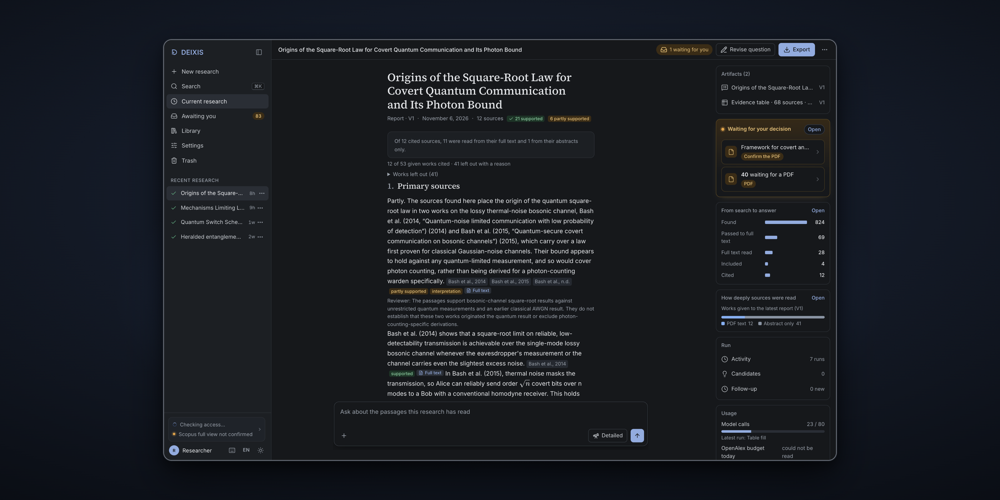
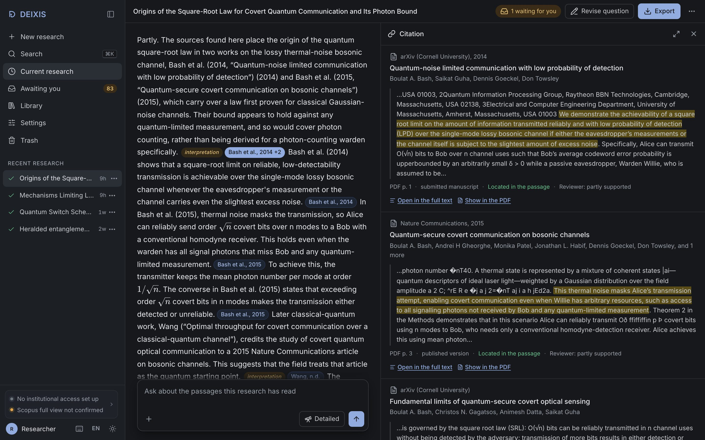
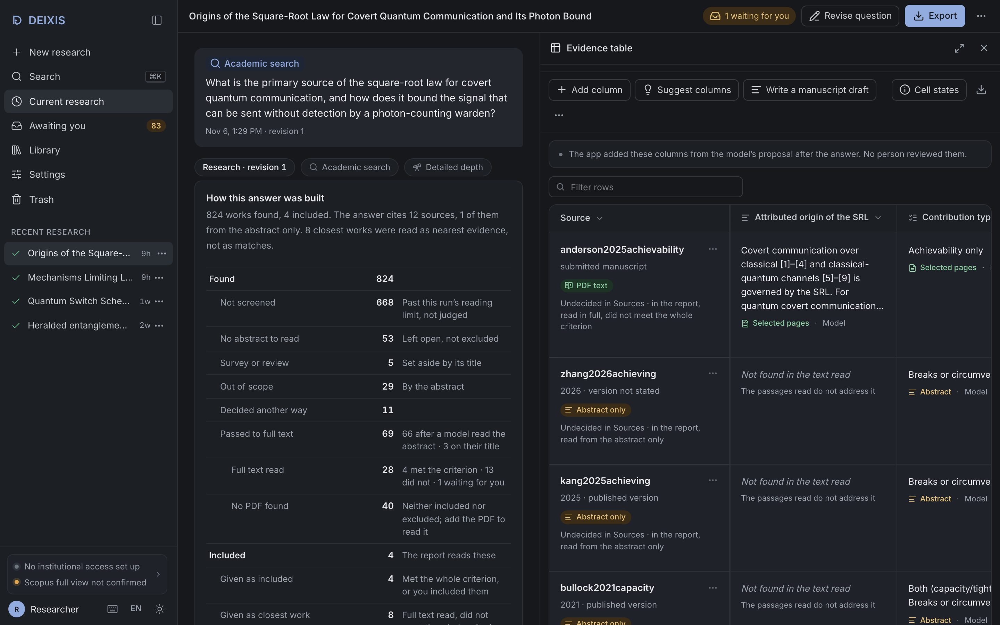

<div align="center">


# DEIXIS

### Local Research Workspace

A desktop app that answers questions from the scientific literature, with every citation pointing to a passage you can open.


<br>
<a href="https://deixis.huguryildiz.com"></a>
<a href="https://github.com/huguryildiz/DEIXIS/actions/workflows/ci.yml"></a>
<a href="https://github.com/huguryildiz/DEIXIS/releases"></a>

<h3>
<a href="#what-it-does">What it does</a> ·
<a href="#what-is-checked">What is checked</a> ·
<a href="#install">Install</a> ·
<a href="#run-from-source">Run from source</a>
</h3>

</div>

<br>

<p align="center"></p>

DEIXIS is a desktop app for questions about the scientific literature. You type a research question; it searches the scholarly databases, screens what it finds, reads the full texts it can get and writes an answer. Every citation in the answer opens the exact passage it came from, in the version of the paper that was read.

The app and your library stay on your computer. Searches go to the scholarly sources you connect and model steps go to the model you connect, each with only the input that step needs.

**Try it without installing:** [deixis.huguryildiz.com](https://deixis.huguryildiz.com) runs the real interface on a recorded research. Citations, sources, the evidence table and the menus all work there; a new search needs the download.

## What it does

1. **Plans the search.** Code picks the search words from your question, a model sorts them into concept blocks and writes the query, and the plan is frozen before any request goes out.
2. **Searches and ranks.** OpenAlex keyword and semantic requests, one round of citation chaining and embeddings run together (Semantic Scholar joins at Detailed depth). Up to six signals are fused into one ranked list, and a reranker can reorder the top of it. Nothing is removed at this step.
3. **Screens and reads.** The model screens the abstracts of the top works, twice each. Inclusion needs a full-text read: two model reads, with every quote checked by code against the text.
4. **Answers with located citations.** Each citation has to point to an exact span in a passage the model was given. If one cannot be located, the answer stays an unverified draft.
5. **Keeps reading in the background.** Full texts that were not ready in time keep downloading and can lead to one revision of the answer; the earlier answer is kept.

Each step, with diagrams and the depth numbers: [docs/search.md](docs/search.md). Search benchmark results: [docs/benchmark.md](docs/benchmark.md).

### Around the answer

- Open any citation to read the passage it rests on; a PDF citation opens the document on the cited page.
- Build an evidence table from the included sources. Cells a model filled from an abstract are read again when the full text arrives.
- Ask follow-up questions, screen further down the ranked list, run snowball rounds and look at a citation map of the sources.
- Attach up to five seed PDFs to steer a search, or ask a question about PDFs you attach.
- Write a report from the evidence table and export it as Markdown or LaTeX (IEEEtran).
- Include or exclude any source yourself. Your choice outranks the model and the code, and keeps your reason.

<p align="center">


</p>

## What is checked

| For every answer | Checked by code | Left to you |
|---|---|---|
| The cited words exist in the passage, in the version that was read | Yes | |
| Titles, DOIs, pages and authors come from stored records, not model prose | Yes | |
| Quotes behind an include decision are found in the full text | Yes | |
| The passage supports the claim | No | You read it (each answer says so) |
| A disputed paper is included or excluded | | You decide |
| The question has not been studied before | No | You judge; no search result proves novelty |

Found, screened, read in full, given to the model and cited are kept as separate counts, and each source shows how deeply it was read (metadata, abstract, passage or full text).

## Models and sources

Use a subscription you already pay for, an API key, or a model on your own computer: Claude Code, Codex, Gemini CLI, GitHub Copilot, the Anthropic, OpenAI or Gemini API, Ollama or a local model server. The command-line tools are installed separately; keys go to the system keychain. DEIXIS records which model wrote each step and never switches to another one after a failure without saying so.

Search goes to OpenAlex, plus Semantic Scholar at Detailed depth. Crossref, Semantic Scholar and Scopus fill in missing abstracts; open full texts come through Unpaywall, Europe PMC, arXiv and the public pages of the papers. Scanned PDFs are read with built-in OCR in English and Turkish.

The app is open source under AGPL-3.0. You pay only for the model you connect.

## Install

<a id="install-the-mac-app"></a>

### Mac

For Apple Silicon Macs (M1 and newer) with macOS 13 or later; so far tried only on macOS 27. Intel Macs are not packaged.

1. Download `DEIXIS_<version>_aarch64.dmg` from [Releases](https://github.com/huguryildiz/DEIXIS/releases). Its SHA-256 is listed on the release page: `shasum -a 256 DEIXIS_*.dmg`.
2. Open the DMG and drag DEIXIS into Applications.
3. The app is not signed with an Apple Developer ID, so the first launch is blocked. Open DEIXIS once, then go to System Settings → Privacy & Security, find "DEIXIS was blocked" and choose Open Anyway. Or run this in Terminal once:

   ```sh
   xattr -dr com.apple.quarantine /Applications/DEIXIS.app
   ```

DEIXIS opens in its own window. Closing the window keeps it running in the menu bar, where Quit stops it and everything it started. Your library stays in `~/Library/Application Support/DEIXIS` when you update or delete the app. There is no automatic update: once a day DEIXIS asks GitHub whether a newer version exists and says so in the sidebar (Settings → About turns this off); download the newer DMG and replace the app.

<a id="install-on-windows"></a>

### Windows

A preview for Windows 10 and 11 on x64 PCs. So far it has been tried on a GitHub Windows Server runner and on Windows 11 for ARM running the x64 build under emulation; not yet on Windows 10 or on an ordinary x64 PC.

1. Download `DEIXIS_<version>_x64-setup.exe` from [Releases](https://github.com/huguryildiz/DEIXIS/releases) and check its SHA-256 against the release page: `Get-FileHash .\DEIXIS_*_x64-setup.exe`.
2. Run it. The installer is not signed, so SmartScreen may stop it: choose More info, then Run anyway. It installs for your user only, without an administrator prompt, into `%LOCALAPPDATA%\Programs\DEIXIS`.

DEIXIS opens in its own window. Closing the window keeps it running in the notification area, where Quit stops it and everything it started. Your library stays in `%LOCALAPPDATA%\DEIXIS` when you update or uninstall the app. There is no automatic update: DEIXIS says when a newer version exists (as on macOS); run the newer installer.

Not in the Windows preview: the built-in local models in Settings (keyword search, the Voyage reranker and API embedding connections work), and reading arXiv LaTeX sources (the PDF is read instead).

<a id="install-on-linux"></a>

### Linux

A preview for 64-bit x86 PCs with Ubuntu 22.04 or newer (or a distribution of the same age). It has been tried on GitHub's Ubuntu 22.04 and 24.04 runners under a virtual display, not yet on a desktop. Download the package from [Releases](https://github.com/huguryildiz/DEIXIS/releases) and check its SHA-256 against the release page: `sha256sum DEIXIS_*_amd64.*`.

- `.deb` (Ubuntu, Debian and their relatives): `sudo apt install ./DEIXIS_<version>_amd64.deb`. apt pulls in WebKitGTK and the tray library. `sudo apt remove deixis` removes the app.
- AppImage (any distribution): `chmod +x DEIXIS_<version>_amd64.AppImage`, then run it. It needs FUSE 2 (`sudo apt install libfuse2`, on Ubuntu 24.04 `libfuse2t64`); without it, start it with `--appimage-extract-and-run`.

DEIXIS opens in its own window; closing the window quits it and everything it started. Your library is in `~/.local/share/deixis` (or `$XDG_DATA_HOME/deixis`) and stays when you remove the app. Keys you save go to a desktop keyring that offers the Secret Service (GNOME Keyring; KWallet on recent KDE); without one, Settings says so and keeps them for the session, or in a file only you can read if you choose that. Downloads go to your Downloads folder. OCR works without installing Tesseract. There is no automatic update: DEIXIS says when a newer version exists (as on macOS).

Not yet checked on Linux: the built-in local models in Settings, and a real desktop session (tray, keyring prompts, file manager).

## Run from source

Supported: macOS on Apple Silicon, native arm64 Python 3.12 via [uv](https://docs.astral.sh/uv/), Node 22 with npm 10.

```sh
uv sync
cd web && npm ci && npm run build && cd ..
uv run python -m deixis serve        # opens http://127.0.0.1:8765/
uv run pytest                        # model-free tests
```

Connect a model and sources in Settings; keys go to the system keychain ([`providers.env.example`](providers.env.example) lists the names). Data lives in `~/Library/Application Support/DEIXIS` (or `DEIXIS_DATA_DIR`), never in the repository.

License: [AGPL-3.0-or-later](LICENSE).
