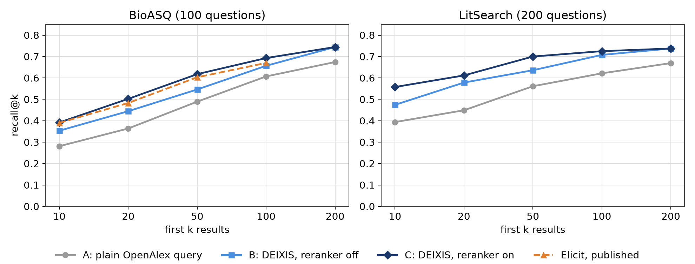
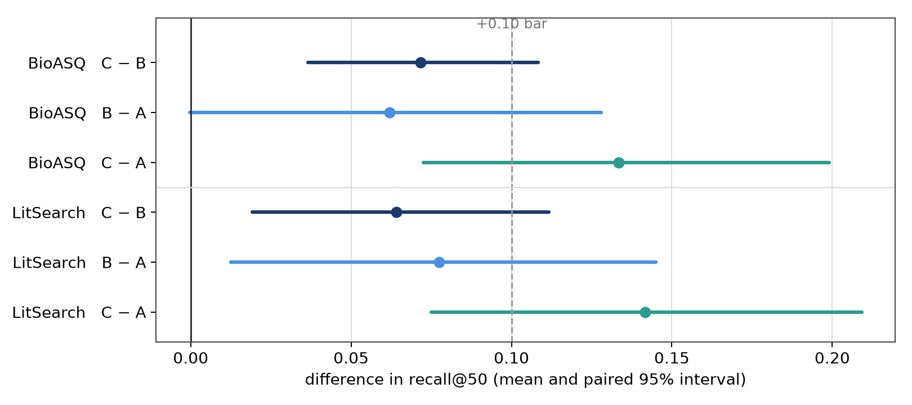

# Search benchmark

## What this measures

This benchmark checks whether papers selected by experts or authors appear near the top of a search result list. It scores the order of candidate papers before DEIXIS screens or reads them. It does not test full-text reading, the answer, or whether a citation supports an answer.

## Question sets

The two sets cover different fields and have different numbers of known papers per question. A *gold paper* is a paper listed as relevant in the set's reference data.

| Set | Questions tested | Questions in set | Mean gold papers per tested question | Field |
|---|---:|---:|---:|---|
| BioASQ | 100 | 5,486 | 10.980 | Biomedicine |
| LitSearch | 200 | 597 | 1.040 | Machine learning and natural language processing |

BioASQ uses expert document lists from its Task B questions. LitSearch uses papers linked to its research questions.

## Search lists compared

Each arm ranks papers for the same questions. The A, B and C scores come from the 18 October 2026 runs.

- **A:** The first 200 results from one OpenAlex keyword query written by the query model.
- **B:** DEIXIS's combined ranking before reranking.
- **C:** The same DEIXIS pool as B, with a reranker changing its order.
- **D:** The ranking rule in use at the 13 November 2026 replay, applied to the stored 18 October pools.

D isolates a change in ranking on the stored papers. It cannot measure later search routes, because papers those routes might find are absent from the stored pools. It also does not replay the later lookup that fills missing abstracts before reranking.

## Settings

The runs used Standard depth and Claude Sonnet 5.5 at medium effort to write queries. DEIXIS used Voyage `voyage-4-lite` for semantic similarity and Voyage `rerank-3-lite` for reranking. C scored the first 200 papers in the combined order. D used a 400-paper reranker window that starts with those 200 papers and fills the rest from other ranking signals. The tables report the first 10, 20, 50, 100 and 200 results.

## Score and uncertainty

Recall@k is the fraction of a question's gold papers found in its first k results, averaged across questions. A paired 95% bootstrap interval repeatedly resamples the same questions for both arms and gives a range for their mean recall difference.

## Results

The tables show mean recall for each arm. Higher values mean more gold papers appear within the stated number of results.

### BioASQ

BioASQ has 100 tested questions. The D ranking changes little at 50 results on the stored pool.

| Arm | @10 | @20 | @50 | @100 | @200 |
|---|---:|---:|---:|---:|---:|
| A: OpenAlex query | 0.281 | 0.364 | 0.489 | 0.607 | 0.674 |
| B: DEIXIS combined order | 0.353 | 0.445 | 0.546 | 0.657 | 0.744 |
| C: DEIXIS reranked | 0.392 | 0.502 | 0.618 | 0.693 | 0.744 |
| D: replayed ranking | 0.415 | 0.505 | 0.620 | 0.694 | 0.745 |

At 50 results, C exceeds A by 0.133 (95% interval: +0.072 to +0.199). C exceeds B by 0.072 (+0.037 to +0.108). D exceeds replayed C by 0.002 (−0.020 to +0.027), so this comparison does not establish an improvement on BioASQ.

### LitSearch

LitSearch has 200 tested questions. D places more gold papers in the first 50 results than replayed C on these stored pools.

| Arm | @10 | @20 | @50 | @100 | @200 |
|---|---:|---:|---:|---:|---:|
| A: OpenAlex query | 0.394 | 0.449 | 0.561 | 0.621 | 0.669 |
| B: DEIXIS combined order | 0.474 | 0.578 | 0.636 | 0.708 | 0.738 |
| C: DEIXIS reranked | 0.558 | 0.612 | 0.700 | 0.725 | 0.738 |
| D: replayed ranking | 0.547 | 0.641 | 0.725 | 0.738 | 0.748 |

At 50 results, C exceeds A by 0.142 (95% interval: +0.075 to +0.209). C exceeds B by 0.064 (+0.019 to +0.112). D exceeds replayed C by 0.025 (+0.005 to +0.050).



The difference chart shows the paired comparisons at 50 results. The D−C intervals use C as recomputed in the replay; its BioASQ score differs slightly from the stored C report.



## Elicit's published figures

Elicit's [published BioASQ search figures](https://elicit.com/blog/evaluating-elicit-paper-search) appear in the recall chart for context. Elicit reports on the full BioASQ set, while these DEIXIS results use a sample of 100 questions. The runs do not share a paired question-level comparison, so the chart is not a statistical comparison with Elicit.

## Limits

These scores describe where listed gold papers appear, not whether the search found every relevant paper. A paper missing from a stored pool cannot be moved upward by reranking. The questions were run once, so the tables do not measure variation in model-written queries or provider timing. One OpenAlex query failed in each set; the arm A mean omits that question, while paired differences count its score as zero. The gold lists may be incomplete, and these results do not validate DEIXIS's reading or answers.

## Reproduce the figures

The figure script reads the stored score reports and replay results. Run this command from the repository root on a machine with the local `notes/` data:

```sh
uv run --with matplotlib python scripts/benchmark/figures.py
```

It writes `assets/benchmark-recall.png` and `assets/benchmark-gains.png`.
