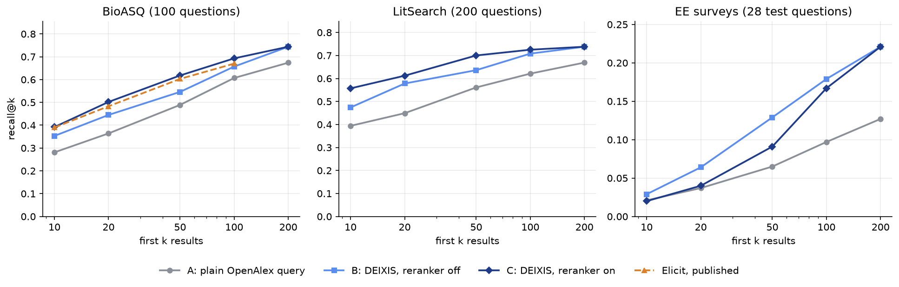
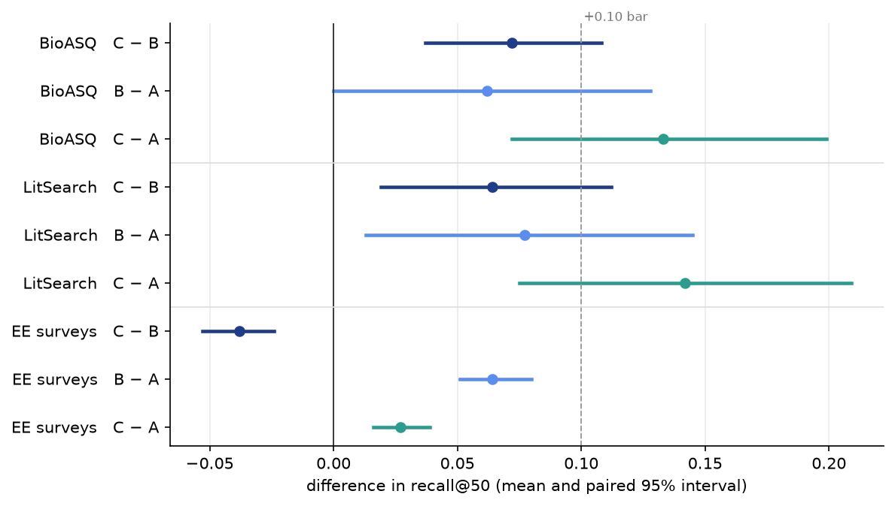

# Search benchmark

Three question sets, run on 2026-10-18 with the owner's settings. Each set has papers chosen by experts or authors for
every question, and the score is how many of them appear near the top of the candidate list. Reading and answers are
not measured.

| Set | Questions | Gold papers per question | Field |
|---|---|---|---|
| **BioASQ** | 100 of 5,486 | about 11 | biomedicine |
| **LitSearch** (Ajith et al., EMNLP 2024) | 200 of 597 | about 1 | ML and NLP |
| **EE surveys** (built here) | 42 (28 test) | median 174 | electrical engineering |

**In short**

- DEIXIS finds more gold papers than one plain OpenAlex query on all three sets.
- The reranker helps on BioASQ and LitSearch. On the EE survey set it hurts, because most of the gold papers there come
  through citation chaining and the reranker pushes chained records down.
- On BioASQ, DEIXIS with the reranker is close to Elicit's published figures.



## Arms and settings

- **A**: one OpenAlex keyword query written by the same model, first 200 results (Elicit's baseline).
- **B**: DEIXIS with the reranker off (the fused order).
- **C**: DEIXIS with the reranker on. B and C come from the same run, so the rerank is the only difference between them.

Settings: Voyage `voyage-4-lite` for semantic similarity, Voyage `rerank-3-lite` for reranking (pool factor 4),
Standard depth, Claude Sonnet 5.5 at medium effort writing the queries. The harness writes these into a temporary data
folder and reads them back before the first question. Every row records them. A provider failure stops the run. It is
never scored as a product result.

Recall@k is the share of a question's gold papers in the first k results, averaged over questions. Intervals are
paired 95% bootstrap intervals over questions (10,000 resamples). A failed question counts as zero in a paired
difference.



## Results

| | @10 | @20 | @50 | @100 | @200 |
|---|---|---|---|---|---|
| **BioASQ (100)** | | | | | |
| A: plain OpenAlex | 0.281 | 0.364 | 0.489 | 0.607 | 0.674 |
| B: DEIXIS, reranker off | 0.353 | 0.445 | 0.546 | 0.657 | 0.744 |
| C: DEIXIS, reranker on | **0.392** | **0.502** | **0.618** | **0.693** | **0.744** |
| C − B | +0.039 (−0.005 to +0.084) | +0.058 (+0.012 to +0.105) | +0.072 (+0.037 to +0.108) | +0.036 (+0.021 to +0.054) | 0 |
| C − A | +0.114 (+0.048 to +0.180) | +0.142 (+0.076 to +0.209) | +0.133 (+0.072 to +0.199) | +0.092 (+0.037 to +0.149) | +0.077 (+0.028 to +0.129) |
| Elicit, as published (5,486 questions) | 0.390 | 0.483 | 0.603 | 0.670 | |
| **LitSearch (200)** | | | | | |
| A: plain OpenAlex | 0.394 | 0.449 | 0.561 | 0.621 | 0.669 |
| B: DEIXIS, reranker off | 0.474 | 0.578 | 0.636 | 0.708 | 0.738 |
| C: DEIXIS, reranker on | **0.557** | **0.612** | **0.700** | **0.725** | **0.738** |
| C − B | +0.083 (+0.026 to +0.142) | +0.033 (−0.020 to +0.085) | +0.064 (+0.019 to +0.112) | +0.018 (−0.005 to +0.043) | 0 |
| C − A | +0.166 (+0.095 to +0.237) | +0.165 (+0.095 to +0.235) | +0.142 (+0.075 to +0.209) | +0.107 (+0.040 to +0.174) | +0.072 (+0.003 to +0.142) |
| **EE surveys (28 test)** | | | | | |
| A: plain OpenAlex | 0.021 | 0.037 | 0.065 | 0.097 | 0.127 |
| B: DEIXIS, reranker off | **0.029** | **0.064** | **0.129** | **0.179** | **0.221** |
| C: DEIXIS, reranker on | 0.020 | 0.040 | 0.091 | 0.167 | **0.221** |
| C − B | −0.009 (−0.014 to −0.005) | −0.024 (−0.030 to −0.018) | −0.038 (−0.053 to −0.024) | −0.012 (−0.020 to −0.005) | 0 |
| B − A | +0.008 (+0.002 to +0.014) | +0.027 (+0.021 to +0.033) | +0.064 (+0.051 to +0.080) | +0.082 (+0.057 to +0.110) | +0.093 (+0.058 to +0.135) |

- The reranker reorders only the top of the list, so B and C are equal at 200.
- BioASQ: Elicit's figures come from all 5,486 questions and ours from a sample, so the two are not compared
  statistically.
- LitSearch: almost every request has one gold paper, so each question scores 0 or 1 and the intervals stay wide.
- EE surveys: a reference list is incomplete and broad gold, so absolute recall is low and only the differences
  between arms are read. B − A at 50 results stays below the +0.10 bar the project set for DEIXIS against a plain query.
- No DEIXIS question failed on any set. A plain OpenAlex query failed once on BioASQ and once on LitSearch.
- Cost: about $0.033 of OpenAlex budget per DEIXIS question on BioASQ and LitSearch, about $0.05 on the EE set (larger
  pools). Voyage cost under $0.01 per question.

## The EE survey set

**How it was built.** Survey articles from 2019 to 2024 with at least 80 references, from IEEE Communications Surveys &
Tutorials, Proceedings of the IEEE, the IEEE magazines for signal processing, antennas, microwaves, control and power,
Annual Reviews in Control and similar venues (IEEE Access only fills a short topic). Seven topics with six surveys
each: wireless and telecom, signal processing, machine learning in EE, antennas and RF, power and energy, control,
underwater and sensor networks. Selection is rule-based and seeded. A survey's gold set is its OpenAlex reference list,
keeping only works OpenAlex has and dates on or before the survey. Claude Sonnet 5.5 writes one question per survey
from its title and abstract, without naming the survey or copying its title. A third of each topic is held out as a
tuning split; the table above is the test split.

**Keeping the comparison fair.** DEIXIS has no date limit, so before scoring both arms lose the survey itself and
every record dated after it, compared by day. DEIXIS also loses any record that only a citation chain from the survey,
or from a later paper, brought in. The list then closes up. The survey was a chain seed in 35 of the 42 DEIXIS runs.
The cleaning removed 2,547 chained records, and more than half of each DEIXIS pool was dated after the survey. The
chaining budget such a seed used up cannot be given back, so this leans against DEIXIS.

**Why the reranker loses here.** Most gold papers are found through citation chaining: 746 of the 909 gold hits in
B's first 50 results have a chain route. The reranker compares only title and abstract with the question, and a
survey's reference list holds many foundational or side papers whose text looks far from the question. In the first
50 results the reranker cuts chained records from 1,164 to 793 and gold hits from 909 to 658. On BioASQ and LitSearch
the gold papers read close to the question, and there the reranker helps.

| Topic (test questions) | A @50 | B @50 | C @50 |
|---|---|---|---|
| Wireless and telecom | 0.081 | 0.132 | 0.118 |
| Signal processing | 0.054 | 0.144 | 0.103 |
| Machine learning in EE | 0.041 | 0.077 | 0.077 |
| Antennas and RF | 0.091 | 0.202 | 0.114 |
| Power and energy | 0.083 | 0.137 | 0.105 |
| Control | 0.044 | 0.104 | 0.050 |
| Underwater and sensor networks | 0.058 | 0.108 | 0.071 |

Each topic has four test questions, so a single topic says little; all seven point the same way.

In one EE question the product's ranking time ran out before the rerank (`no_time_left`, recorded by DEIXIS). That
question counts as the product delivered it, with C equal to B. The 41 reranked questions give the same C − B
(−0.038).

## Papers DEIXIS never retrieved

These are gold papers that plain OpenAlex has in its first 200 but that never enter DEIXIS's candidate list: 17 on
LitSearch (12% of the gold papers plain OpenAlex found) and 57 on BioASQ (9%). DEIXIS's own queries were run again on
OpenAlex (title and abstract search, up to 2,000 results each) to find the cause.

| Why | LitSearch | BioASQ |
|---|---|---|
| None of DEIXIS's queries matches the paper | 12 | 23 |
| A query matches, but the paper sits past the 500 records read per query | 5 | 34 |
| Read, then lost later (year filter, duplicates, type) | 0 | 0 |

- **The query leaves out a name or adds a topic.** For the ZEB2 question, five gold papers use the gene's old name,
  ZFHX1B, which the plain query lists and DEIXIS's does not. For the Westermark sign, DEIXIS adds a "chest
  radiography" block the question never mentions.
- **The query is too broad for the depth read.** A second query of one or two words (`bromocriptine`, 11,005 results)
  pushes the topic's own papers past 500. Reading 1,000 records would add at most 16 of the 57 BioASQ papers.
- **Full text.** The plain query uses OpenAlex `search=`, which also matches full text; DEIXIS searches title and
  abstract only, by design. In 13 of the 17 LitSearch losses the plain query does not match the title or abstract
  either.
- Some BioASQ gold papers are only loosely on the question, so not every loss is a DEIXIS error.

## Method notes

- **Matching.** A result matches a gold paper by OpenAlex id, PMID (BioASQ), DOI, then normalized title.
- **BioASQ.** Questions from the 2b–13b golden enriched test sets of Task B (2014–2025), 5,486 in all, the count
  Elicit reports; a fixed seed (`20261017`) draws 100. Records after the question's challenge year are removed from
  DEIXIS's list afterwards; this removed no gold paper.
- **Query repair.** When OpenAlex rejects arm A's query, the model repairs it once, as in Elicit's method.
- **Query pause.** If DEIXIS pauses on a query the model wrote, the harness resumes it once, as a person would.
- **Earlier run.** A 17 Oct BioASQ run with Gemini embedding and no reranker gave DEIXIS 0.545 at 50 results against
  0.489 for plain OpenAlex. In that run 27% of the gold papers never entered the list and 22% sat below position 100.

## Not measured

- Reading and answers. Only the order of the candidate list is measured.
- Run-to-run variance: each system ran once, and the model's query writing varies between runs.
- Elicit's LLM-judged evaluation on real user searches; DEIXIS has no shared search log.
- Whether the missed papers would rank well once in the pool, and the fixes for the query patterns above.
- Recall depends a little on provider speed, since Standard depth has stage deadlines.
- A gold set is not exhaustive, and a passing benchmark is not scientific validation of DEIXIS's answers.

## Reproduce

Each set has a runner with `prepare`, the arm commands, `preflight` and `score`. Start a DEIXIS server on its own port
with a temporary `DEIXIS_DATA_DIR`, never the library on 8765.

```sh
uv run python scripts/benchmark/bioasq_run.py prepare --n 100   # BioASQ zips under .local/bioasq/raw/ (free account)
uv run python scripts/benchmark/bioasq_run.py openalex --prepaid-floor 1
uv run python scripts/benchmark/bioasq_run.py deixis --base http://127.0.0.1:8766 --data-dir .local/bioasq/data --prepaid-floor 1
uv run python scripts/benchmark/bioasq_run.py score
```

`litsearch_run.py` and `eesurvey_run.py` take the same commands. Code: `scripts/benchmark/` (`harness.py` holds the
settings check, the stop rule and the budget floor). Tests: `tests/measurement/`.
