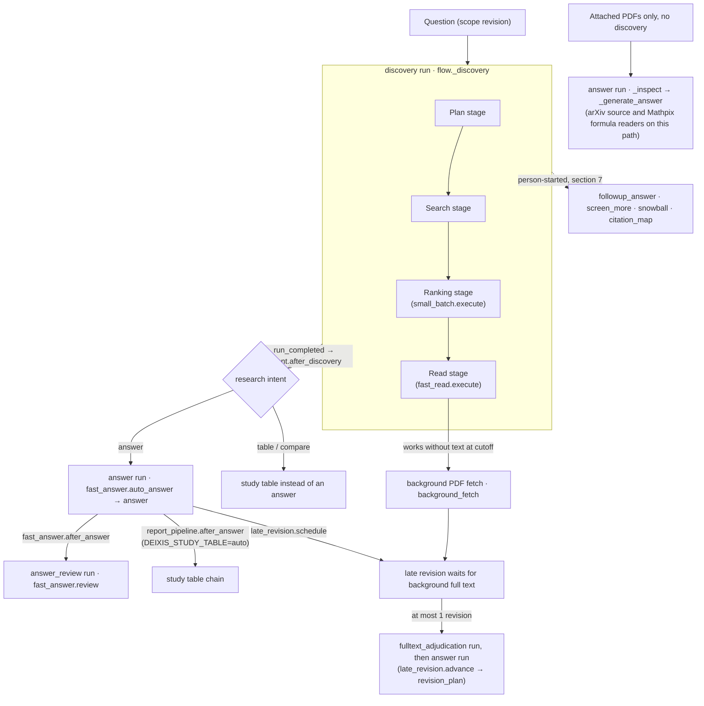
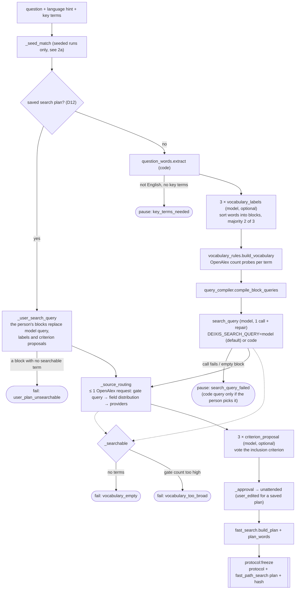
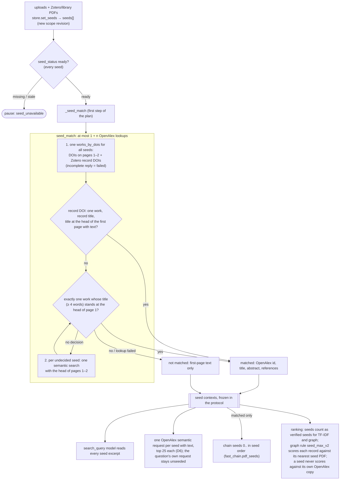
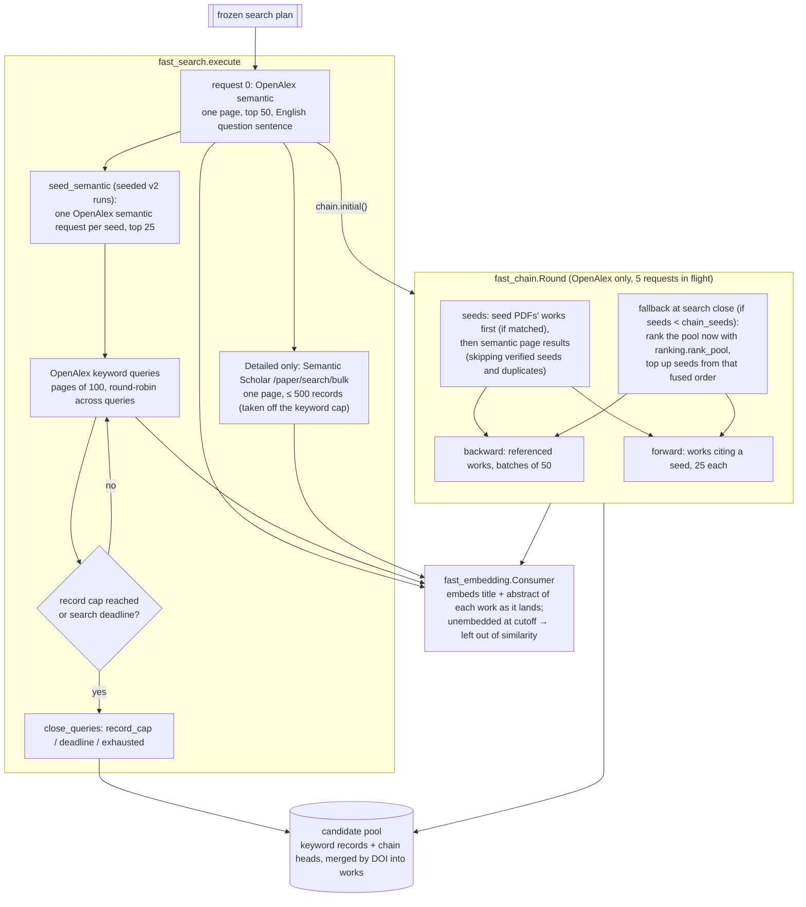
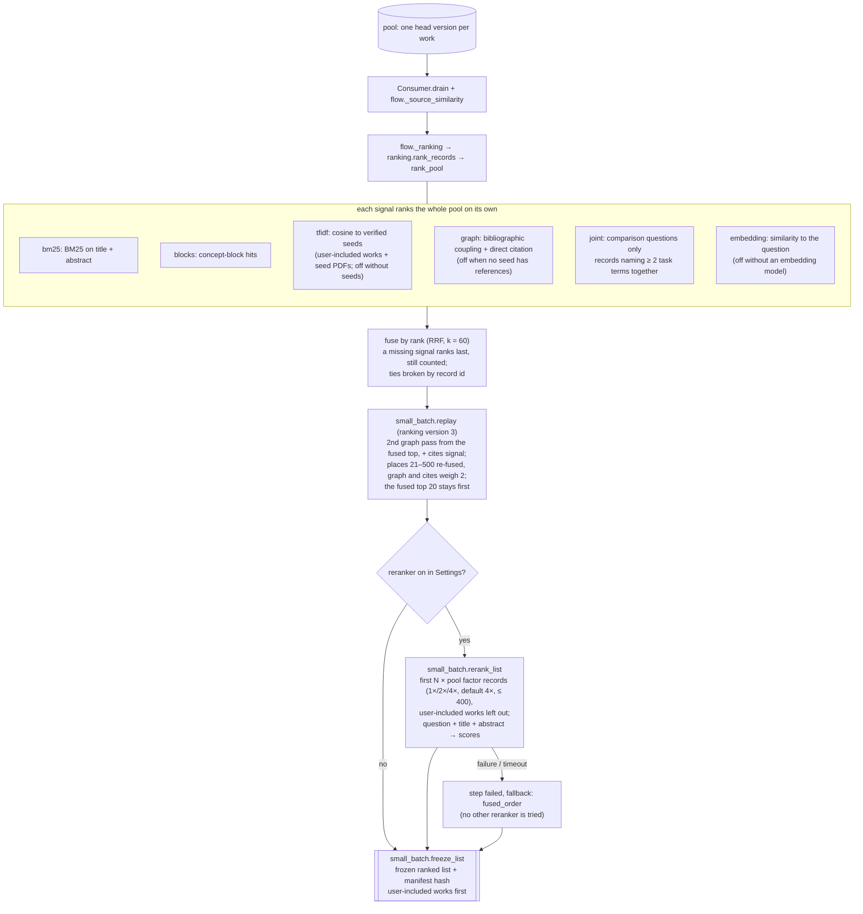
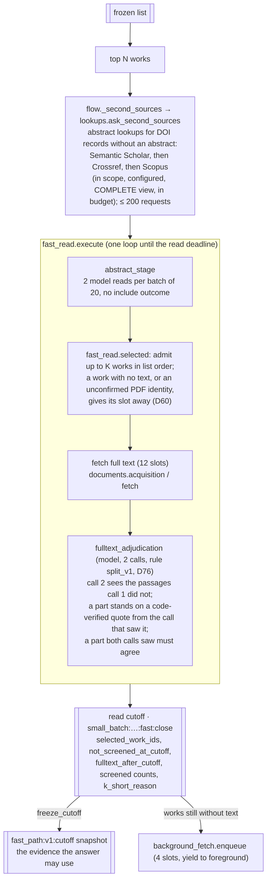
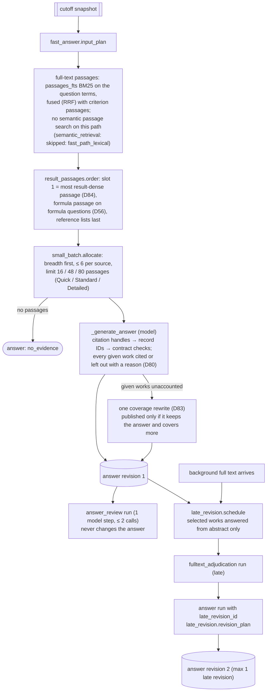
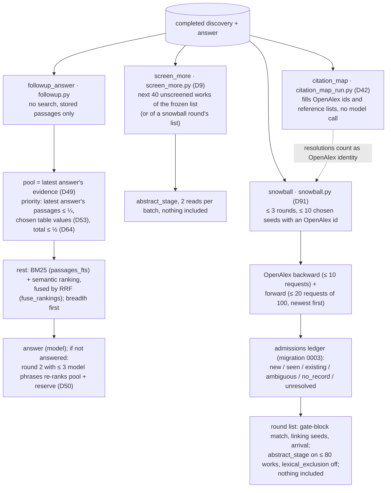

# Search architecture

This document traces how a DEIXIS question becomes a set of sources that are ranked, read and answered. It describes the code at commit `8cbedaea` on 17 Oct 2026, under policy `fast_path_v1`, seed rule `seed_pdf_v2` (D3, D6) and ranking version 3. Every box names the function or module that does the work, so the diagrams can be checked against the code. Paths are relative to `backend/deixis/`.

A discovery run always takes the fast path. It has five stages, each on its own clock with a soft deadline: plan, search, ranking, read and answer. When a discovery run completes, an answer run is queued automatically, and an answer review run follows it. Full text that arrives after the read cutoff can produce one late revision of the answer. A person can start four more kinds of run on a finished research: follow-up questions, Screen more, snowball rounds and the citation map (section 7).

**Ranking in one sentence.** Several signals each rank the whole pool by themselves, and the ranks are fused, never the raw scores. BM25 is one of those signals. It is not a filter that runs before the embedding, and no signal removes a record (section 4).

## 1. Runs end to end

`flow._execute_run` dispatches every run kind. The ranking and read stages run inside `small_batch.execute`, and `_discovery` has no separate read call. Under the `papers`, `table` and `compare` intents the budget sets `auto_answer: false`, so no answer is queued (`fast_path.py`).

## 2. Plan stage

Code picks the search words. Models only help: they sort the words into blocks, write the query and propose the inclusion criterion. The protocol and its search plan freeze before the first request that fetches results.

Several steps are skipped when there is nothing for them to do:

- The vocabulary labels are skipped for a saved plan, for key terms the person typed, or when there are no phrases or more than 40.
- The query step is skipped when the person gave key terms. A query that an earlier run already wrote for the same scope revision is reused.
- The criterion proposals are skipped for a saved plan. A criterion that is already frozen for the same question is reused.
- Routing marks providers the person left out of a saved plan as `excluded_by_user`. OpenAlex cannot be left out.

## 2a. Seed PDFs (optional, `seed_pdf_v2`, D3 and D6; one seed behaves as D2)

The person's own PDFs guide the search. There can be up to five, and uploaded files count the same as Zotero or library PDFs. Seeds need the "Files + academic search" source scope.

- `store.seed_candidates` decides which sources can be seeds.
- `store.set_seeds` freezes them, in order, into a new scope revision with a bounded reading of each: four passages and 5,600 characters in all, split evenly across the seeds.
- With more than five candidates, the five that share the most words with the question are taken.
- Changing the seeds drops a saved search plan.

The first step of the plan stage is `_seed_match`, which looks up which OpenAlex work each PDF is. The protocol freezes the answers, and later steps read them only from the protocol. A run that started under `seed_pdf_v1` finishes under v1.

## 3. Search stage (chain and embedding run alongside)

Three things run at once: the search requests, one round of the citation chain, and an embedding consumer that embeds records as they arrive. Each one stops at its stage cutoff.

The fast path searches only OpenAlex, plus Semantic Scholar in Detailed. The registry also holds IEEE Xplore, Scopus, PubMed, Crossref, arXiv, bioRxiv, CORE and SerpAPI. Planned queries for those providers are dropped with the reason `openalex_only`, or marked `excluded` when the person left them out. Crossref, Semantic Scholar and Scopus come back later only to look up abstracts (section 5).

The embedding providers are listed in `documents/embeddings.py`: Gemini, OpenAI, Voyage, Cohere, Ollama, LM Studio, the built-in model and off. The built-in model runs in llama.cpp from a pinned GGUF catalog in `documents/builtin_catalog.py`, which holds Qwen3 Embedding 0.6B, 4B and 8B and BGE-M3 (D90). The embedding query is the question's English sentence.

## 4. Ranking stage

The ranking stage decides the order in which works are read. It removes nothing and decides nothing. Code computes every signal. The one model-like step is the optional reranker, and it changes only the order.

**Signals.** `ranking.CODE_SIGNALS` holds `bm25`, `blocks`, `tfidf`, `graph` and `joint`, and `SIGNALS` adds `embedding`. A signal that cannot run is recorded with a reason, such as `no_verified_seeds`, `not_a_comparison` or `no_stored_similarity`. The ranking still uses the signals that did run.

The `joint` signal applies only when the question asks for a comparison. Code checks for this from words in the question or its English sentence, such as "compare", "versus", "between" or "than". Records that name two or more of the task block's terms together score higher, and a term counts more when it is rarer in the pool.

**Fusion.** Each record's score is the sum of `1/(60 + rank)` over its signals. `fused_code` is the order from the code signals alone. `fused` is the order from every signal that ran, and screening follows it.

**Replay.** The frozen list is computed again from the stored manifest by `small_batch.replay`, so it never depends on live code or on set order. Ranking version 3 adds two things on top of `rank_pool`:

- A second graph pass whose seeds come from the fused top, not from the keyword top. A seed's citation of a record counts twice.
- A `cites` signal: the logarithm of the OpenAlex cited-by count.

Places 21 to 500 are then fused again, with graph and cites weighted twice. The original top 20 stays in front.

**Reranker** (D88, D89, D90). It is off by default. When it is on, it scores the first `N × pool factor` records of the fused order, so it decides which records fall above the read cutoff, not only their order within it. It is sent the original question with each record's title and abstract, and an item over 20,000 characters is refused, not cut. It waits for the shorter of its own time limit (default 180 s) and what is left of the ranking stage.

A reranker that fails or runs out of time ends the step as `failed`, with a reason and `fallback: fused_order`. The list keeps the fused order, and no other reranker is tried. If a person's include moved the head of the list during the request, the scores are not applied (`candidates_changed`).

The available rerankers are the built-in model, Voyage, Cohere, Jina and ZeroEntropy. The built-in catalog holds Qwen3 Reranker 0.6B, 4B and 8B and BGE Reranker v2 M3, all running in llama.cpp. The step `rerank:v1:list` stores the provider, model, candidates, scores and what was sent, and the listing's `reranker` block shows the outcome.

## 5. Read stage

Only the top N of the frozen list is read. Abstract screening never includes a source, because inclusion needs a full-text read. At most K works get full text before the cutoff, and the rest go to the background fetch queue.

The adjudication decides each part of the criterion on its own:

- A part is included only when every part has a verified quote.
- An unverified quote gives `include_quote_unverified`, which goes to the person's queue.
- A verified quote set against an "absent" from a call that saw the same text gives `fulltext_runs_disagree`.
- A work is excluded only when both calls say absent.

The abstract stage sets aside survey-titled works by code (`code_decided`, D69).

## 6. Answer, review and late revision

The answer's passages come from BM25 and fusion with the criterion passages. No embedding is used at this step. A person-started answer can also read works that Screen more or a snowball round screened after the cutoff, as abstract-based evidence (D9). Automatic answers and late revisions leave those works out. A work that a late full-text read excluded stays out of later answers and follow-ups (D44). A late revision waits while a newer question revision is still unused and can be withdrawn (D67).

The arXiv LaTeX source reader (D36) and the Mathpix formula reader (D40) are not on this path. They run for attached-PDF answers and for study tables.

## 7. Person-started runs on a finished research

None of these runs is part of the automatic chain. A person starts each one from the interface.

A follow-up question is the one place where embeddings rank passages. Its lexical BM25 ranking and its semantic ranking are fused by RRF. When the follow-up's own words match nothing, it falls back to the research question's words.

In a snowball round the abstract stage runs with `lexical_exclusion=False`. The rule that sets aside a record naming neither gate block is off, because the round's works came from citations of seeds the person chose. A round's works reach a later answer only after the person includes them.

## Mode numbers

The numbers come from `fast_path.MODES` and are frozen into each run's budget by `fast_path.freeze_budget`. Stage times are soft deadlines in seconds. Time a stage leaves unused carries over to the next one. Runs on a local model have no read or answer deadline.

| Mode | plan / search / ranking / read / answer (s) | N read | K full text | keyword record cap | chain seeds | backward / forward requests | answer passages |
|---|---|---|---|---|---|---|---|
| Quick | 30 / 30 / 30 / 60 / 30 | 25 | 10 | 450 | 10 | 2 / 2 | 16 |
| Standard | 30 / 45 / 60 / 120 / 45 | 50 | 20 | 1000 | 20 | 4 / 8 | 48 |
| Detailed | 45 / 90 / 120 / 270 / 75 | 100 | 40 | 2000 (1500 OpenAlex + 500 S2) | 30 | 8 / 16 | 80 |

Other frozen numbers:

- OpenAlex semantic top: 50
- Backward and forward page sizes: 50 and 25
- Chain requests in flight: 5
- Embedding threads: 4
- Fetch slots: 12, background slots: 4
- Arrival margin: 5,000 ms

## What makes it resumable

Every step is a `run_steps` row keyed by `operation_key`. A step that already `succeeded` returns its stored output, so pause, resume and crash recovery repeat no model call and no provider request. A finished rerank, whether it succeeded or failed, is not asked again. A coverage call that was already sent is recovered from its own sessions.

Four things are each frozen once and read back on resume: the protocol, the search plan, the ranked list with its manifest, and the read cutoff. `_checkpoint` stops a run on pause, on cancel, or when a newer scope revision appears. On start, `worker.py` marks half-finished work `outcome_unknown` or `paused` instead of retrying it, and `background_fetch.recover` re-queues running fetches.

## Where to look

| Part | Code |
|---|---|
| Run dispatch, discovery orchestration | `workflow/flow.py` (`_execute_run`, `_discovery`) |
| Policy, mode numbers, stage clock | `workflow/fast_path.py` |
| Seed PDF match | `workflow/seed_match.py`, `flow._seed_match`, `store.set_seeds`, `store.seed_candidates` |
| Saved search plan | `flow._user_search_query`, `workflow/user_plan.py` |
| Search requests | `workflow/fast_search.py` |
| Citation chain round | `workflow/fast_chain.py` |
| Embedding during search | `workflow/fast_embedding.py`, `documents/embeddings.py`, `documents/builtin_catalog.py` |
| Ranking signals | `workflow/ranking.py` |
| Replay, reranker, frozen list, read entry | `workflow/small_batch.py`, `documents/rerankers.py` |
| Second-source abstracts | `workflow/lookups.py` |
| Abstract screening, full-text rule | `workflow/abstract_stage.py`, `workflow/adjudication.py` |
| Read window, K admission, cutoff | `workflow/fast_read.py` |
| Full-text fetch | `documents/acquisition.py`, `documents/fetch.py` |
| Answer, review | `workflow/fast_answer.py`, `workflow/result_passages.py`, `workflow/formula_passages.py` |
| Late full text and revision | `workflow/background_fetch.py`, `workflow/late_revision.py` |
| Follow-up questions | `workflow/followup.py` |
| Screen more, snowball, citation map | `workflow/screen_more.py`, `workflow/snowball.py`, `workflow/citation_map_run.py` |
| Restart recovery | `workflow/worker.py` |
| Providers and query rules | `providers/` (`registry.py`, `query_rules.py`) |
