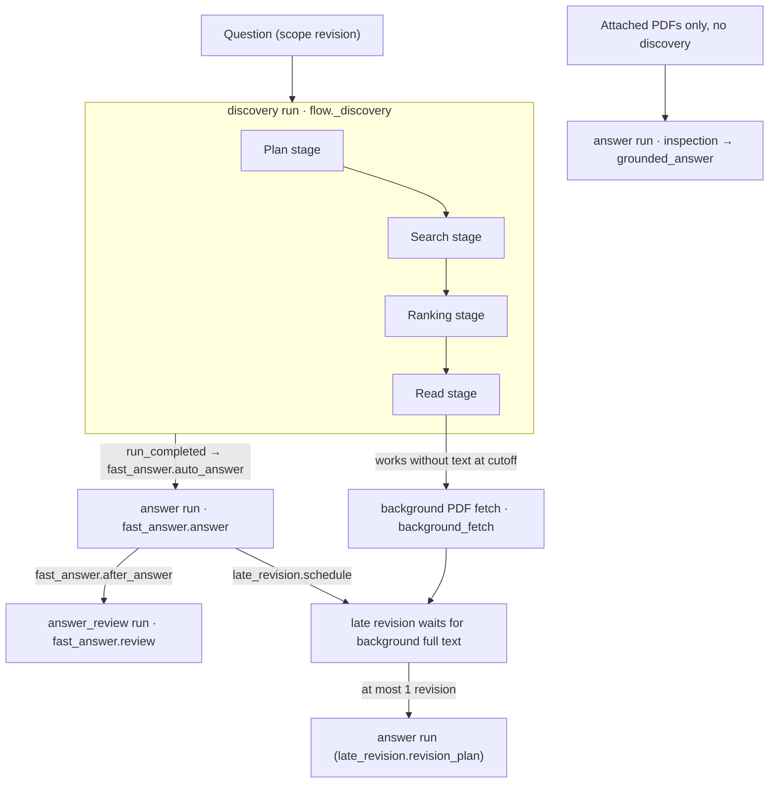
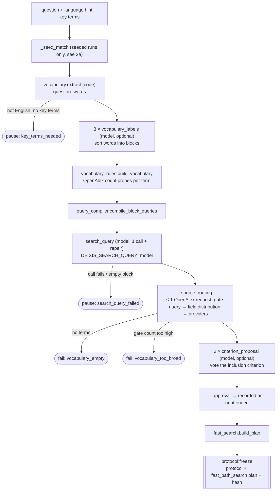
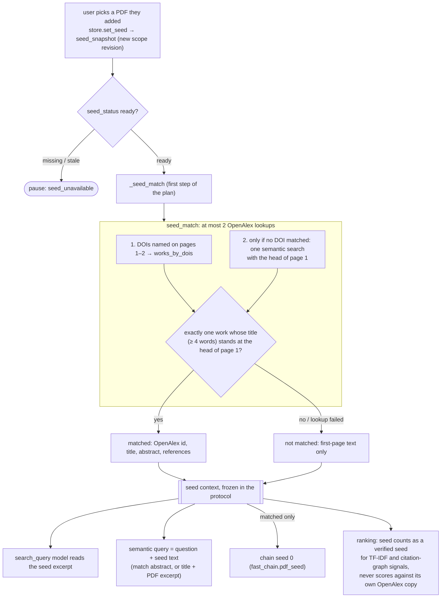
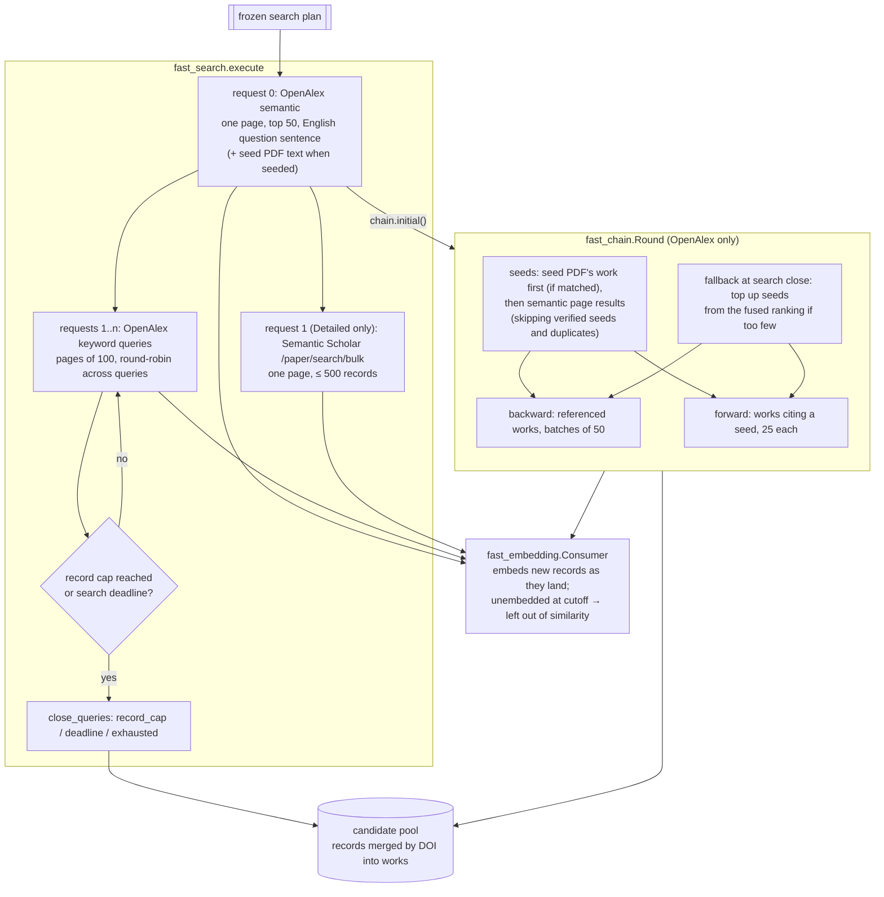
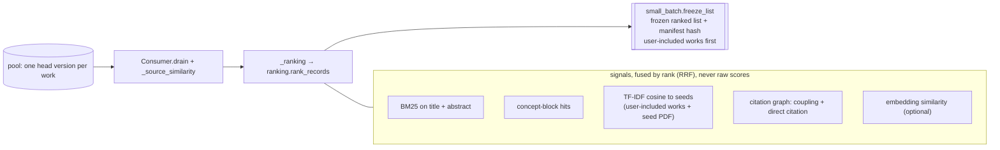
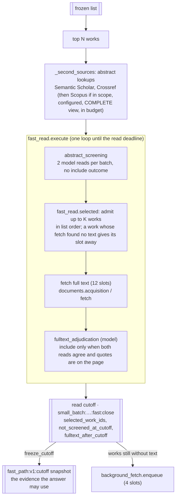
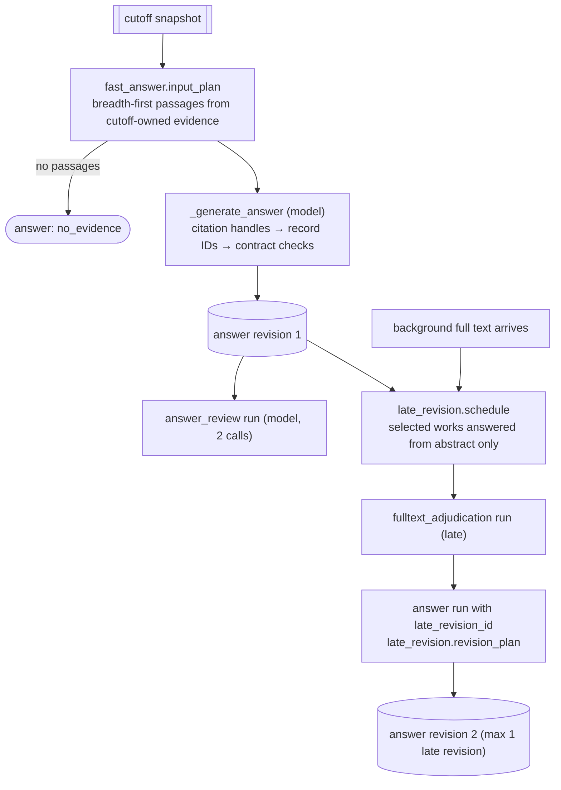

# Search architecture

How a DEIXIS question becomes a ranked, read and answered set of sources, as the code stands on 11 Oct 2026 at commit `0566682` (policy `fast_path_v1`, seed rule `seed_pdf_v1`). Every box names the function or module that does the work, so the diagrams can be checked against the code.

A discovery run always takes the fast path. It moves through five clocked stages (plan, search, ranking, read, answer), each with a soft deadline. When it completes, an answer run is queued automatically, then an answer review run. Full text that arrives after the read cutoff can produce one late answer revision.

## 1. Runs end to end

## 2. Plan stage

Code picks the search words; models only help sort them, write the query and propose the criterion. The protocol, with its search plan, freezes before the first request that fetches search results.

## 2a. Seed PDF (optional, `seed_pdf_v1`, D2)

The user can pick one of their own PDFs as a seed. This needs the "Files + academic search" source scope. `store.set_seed` freezes a bounded reading of the PDF in a new scope revision: the first two pages plus the pages that share the most words with the question. Before anything else in the plan stage, `_seed_match` looks up which OpenAlex work the PDF is. The protocol freezes that answer, and later steps read it only from the protocol.

## 3. Search stage (with chain and embedding running alongside)

Three things run at once: the search requests, one citation-chain round, and an embedding consumer that embeds records as they arrive. All three stop at their stage cutoffs.

## 4. Ranking stage

Ranking is code only. It orders the pool for reading; it removes nothing and decides nothing.

## 5. Read stage

Only the top N of the frozen list is read. Abstract screening never includes a source; inclusion needs a full-text read. At most K works get full text before the cutoff; the rest go to the background fetch queue.

## 6. Answer, review and late revision

## Mode numbers

From `fast_path.MODES`, frozen into each run's budget by `fast_path.freeze_budget`. Stage times are soft deadlines in seconds; time a stage leaves unused carries over to the next one.

| Mode | plan / search / ranking / read / answer (s) | N read | K full text | keyword record cap | chain seeds | backward / forward requests |
|---|---|---|---|---|---|---|
| Quick | 30 / 30 / 30 / 60 / 30 | 25 | 10 | 450 | 10 | 2 / 2 |
| Standard | 30 / 45 / 60 / 120 / 45 | 50 | 20 | 1000 | 20 | 4 / 8 |
| Detailed | 45 / 90 / 120 / 270 / 75 | 100 | 40 | 2000 (1500 OpenAlex + 500 S2) | 30 | 8 / 16 |

## What makes it resumable

Every step is a `run_steps` row keyed by `operation_key`. A step that already `succeeded` returns its stored output, so pause, resume and crash recovery repeat no model call and no provider request. The protocol, the search plan, the ranked list and the read cutoff are each frozen once and read back on resume. `_checkpoint` stops a run on pause, cancel or a newer scope revision; `worker.py` marks half-finished work `outcome_unknown` or `paused` on start instead of retrying it.

## Where to look

| Part | Code |
|---|---|
| Run dispatch, discovery orchestration | `backend/deixis/workflow/flow.py` (`_execute_run`, `_discovery`) |
| Policy, mode numbers, stage clock | `workflow/fast_path.py` |
| Seed PDF match | `workflow/seed_match.py`, `flow._seed_match`, `store.set_seed` |
| Search requests | `workflow/fast_search.py` |
| Citation chain round | `workflow/fast_chain.py` |
| Embedding during search | `workflow/fast_embedding.py` |
| Ranking signals | `workflow/ranking.py` |
| Frozen list, read entry | `workflow/small_batch.py` |
| Read window, K admission, cutoff | `workflow/fast_read.py` |
| Answer, review | `workflow/fast_answer.py` |
| Late full text and revision | `workflow/background_fetch.py`, `workflow/late_revision.py` |
| Providers and query rules | `backend/deixis/providers/` (`registry.py`, `query_rules.py`) |
