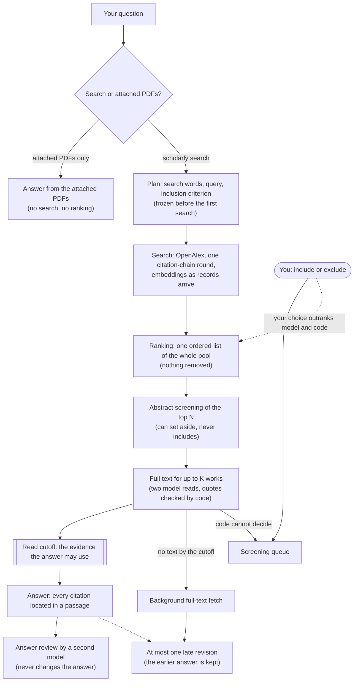
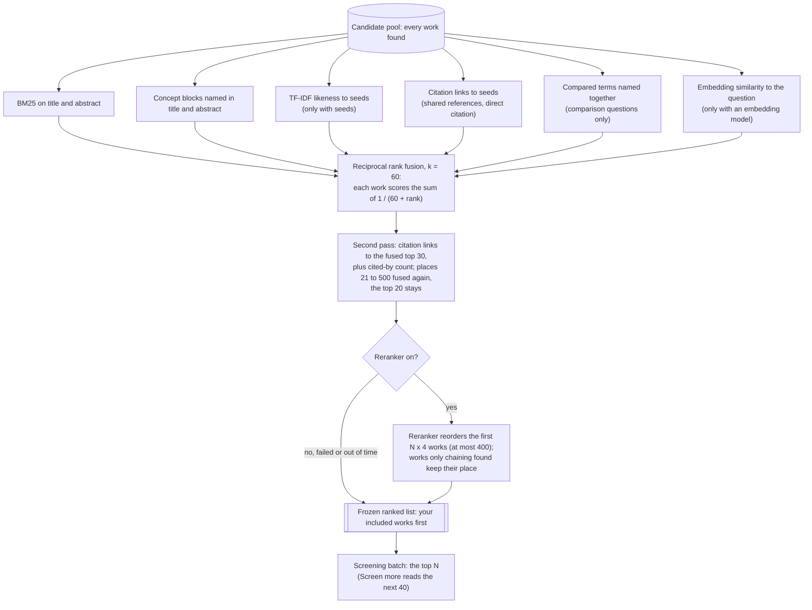

# How DEIXIS searches, ranks and reads

This page follows a question from the moment you ask it to the answer. It describes the current code (run policy `fast_path_v1`). How well the ranking does on three test sets is in [benchmark.md](benchmark.md).

A run has five stages: plan, search, ranking, read and answer. Each stage has a soft deadline, and time a stage leaves unused carries over to the next. Every step is stored, so a paused or crashed run resumes without sending the same model call or provider request twice.

You decide in three places. Works the code cannot settle go to the screening queue: a quote the code could not find in the text, two model reads that disagree, a title that names a study protocol, or a criterion with a comparator part where both reads say no. Your include or exclude outranks any model or code decision and keeps its reason. Works you include go to the top of the next ranked list and serve as seeds for the ranking. Screen more, follow-up questions, snowball rounds and the citation map start only when you start them.

## Where the search goes

The registry ([providers/registry.py](../deixis/providers/registry.py)) holds OpenAlex, Semantic Scholar, Crossref, arXiv, bioRxiv, PubMed, IEEE Xplore, Scopus, CORE and SerpApi. A discovery run searches only OpenAlex: one semantic request (the top 50 for the question's English sentence) and keyword requests in pages of 100, taken in turn across the queries until the record cap or the search deadline. OpenAlex keyword search covers title and abstract, not full text. At Detailed depth one Semantic Scholar bulk request adds up to 500 records. Queries planned for the other providers are dropped and the plan records why (`openalex_only`). For the top N works that lack an abstract, Semantic Scholar, then Crossref, then Scopus are asked for one, at most 200 requests per run.

## How the query is built

Code picks the search words from your question. It does not translate: a question that is not in English and has no English key terms pauses and asks for them. A model sorts the words into concept blocks (asked three times), and code counts each term on OpenAlex. A second model call writes the keyword query: up to six terms with backups. Code counts each term alone and together with the other block, and a term that finds nothing alone is replaced by its next backup. The model's query and the code's own query are both searched. If the model call fails, the run pauses; the code's query is searched alone only if you choose it. A search plan you saved replaces the model's query. Three model calls propose the inclusion criterion. The protocol, with its search plan, is frozen before any request that fetches results.

## Seed PDFs

You can attach up to five seed PDFs. Each is matched to an OpenAlex work from its first two pages: a work counts only when its title stands at the head of page 1 and exactly one work fits. The match is frozen in the protocol. The query writer reads each seed's excerpt, each seed with text sends its own OpenAlex semantic request (top 25), matched seeds become the first citation-chain seeds, and in the ranking seeds count like works you included.

## Citation chaining and embeddings

While the keyword pages arrive, one round of citation chaining runs on OpenAlex. Its seeds are the matched seed PDFs, then the works the semantic request returned. Backward requests fetch the works they cite in batches of 50; forward requests fetch up to 25 works that cite each seed. If the round has fewer seeds than the depth allows when the search stage closes, the pool is ranked at that moment and the gap is filled from the top. At the same time an embedding model (Gemini, OpenAI, Voyage, Cohere, Ollama, LM Studio, a built-in model, or none) embeds each record's title and abstract as it lands. A record not embedded by the cutoff gets no embedding score.

## Ranking

The ranking sets the order in which works are read. It removes nothing and decides nothing.

Each signal ranks the whole pool on its own, and the ranks are fused, never the raw scores. A signal that cannot run (no seeds, not a comparison question, no embedding model) is left out and the run records why. A work a signal cannot score (TF-IDF without an abstract, the graph without a reference list) is ranked last in that signal but still counts. Ties are broken by record id, so the same input always gives the same list, and the list is recomputed from a stored manifest rather than from live code.

The second pass reseeds the citation signal from the 30 best-placed works that have a reference list, adds a signal from each work's OpenAlex cited-by count, and fuses places 21 to 500 again with those two signals counted twice. The reranker is on by default (Voyage `rerank-3-lite`; it needs a Voyage key, and without one nothing is sent and the fused order stands). It reads only the question and each work's title and abstract. If it fails or runs out of time, the list keeps the fused order and no other reranker is tried.

## Reading

Only the top N of the frozen list is screened. The abstract stage reads works in batches of 20, two model reads per batch, after code settles what title and abstract already decide. It can set a work aside or mark it a candidate; it never includes one, because inclusion needs a full-text read. At most K works get full text before the cutoff, in list order; a work whose text cannot be found, or whose PDF is not confirmed to be that work, gives its slot to the next one. Full-text adjudication makes two model calls that see different passages. Code verifies each quote, and a work is included only when every part of the criterion has a verified quote. Works still without text at the cutoff go to a background fetch queue.

## The answer

The answer reads what the cutoff froze: passages from the full text of included works and the abstracts of screened works that were not excluded. Full-text passages are ranked by BM25 on the question's terms, fused (RRF) with the passages that match the criterion; there is no semantic passage search here. Passages are shared breadth first, at most 6 per work. A citation must point to an exact anchor in a passage the answer step was given, or the answer stays an unverified draft. If background full text arrives later, it can produce one revision. The attached-PDFs-only path skips search and ranking: the answer ranks the PDFs' passages by BM25, fused with a semantic ranking when one is available, and a short single PDF can go in whole.

## Depth numbers

From `MODES` in [fast_path.py](../deixis/workflow/fast_path.py), frozen into each run when it starts. Runs on a model that runs on your own computer have no read or answer deadline.

| | Quick | Standard | Detailed |
|---|---|---|---|
| Stage deadlines, plan / search / ranking / read / answer (s) | 30 / 30 / 30 / 60 / 30 | 30 / 45 / 60 / 120 / 45 | 45 / 90 / 120 / 270 / 75 |
| Works screened by abstract (N) | 25 | 50 | 100 |
| Works read in full text before the cutoff (K) | 10 | 20 | 40 |
| Keyword records read | 450 | 1,000 | 2,000 (500 from Semantic Scholar) |
| Chain seeds; backward / forward requests | 10; 2 / 2 | 20; 4 / 8 | 30; 8 / 16 |
| Answer passages (at least) | 16 | 48 | 80 |

The answer's passage count rises above these when there are more works to cover, so every work in the answer input gets room.

## What the benchmark measures

The score in [benchmark.md](benchmark.md) is recall@k: the share of a question's gold papers (chosen by experts or survey authors) that appear in the first k places of the ranked list, averaged over questions. It measures search and ranking only. Screening, full-text reading and answers are not scored.

## Limits

- Ranks, embeddings, cited-by counts, the reranker and model screening are priority signals, not relevance verdicts. A work low in the list was not judged irrelevant; it was not read.
- Found, screened, read in full, given to the model and cited are separate counts, and each work keeps its reading depth (metadata, abstract, passage, full text). A large pool says little about how much was read.
- Only OpenAlex is searched (plus Semantic Scholar at Detailed), and the keyword search does not match full text.
- Code checks that each citation points to a located passage. It does not check that the passage supports the claim; the answer review is one more model's opinion.
- Deadlines make results depend a little on provider speed, and no search result proves a question is new.

## Where it lives in the code

- [workflow/fast_path.py](../deixis/workflow/fast_path.py): stages, deadlines, depth numbers
- [workflow/flow.py](../deixis/workflow/flow.py): plan stage and run order
- [workflow/search.py](../deixis/workflow/search.py), [workflow/fast_chain.py](../deixis/workflow/fast_chain.py), [workflow/fast_embedding.py](../deixis/workflow/fast_embedding.py): search stage
- [workflow/ranking.py](../deixis/workflow/ranking.py), [workflow/small_batch.py](../deixis/workflow/small_batch.py), [documents/rerankers.py](../deixis/documents/rerankers.py): ranking and the frozen list
- [workflow/read.py](../deixis/workflow/read.py), [workflow/abstract_stage.py](../deixis/workflow/abstract_stage.py), [workflow/adjudication.py](../deixis/workflow/adjudication.py): reading
- [workflow/answer.py](../deixis/workflow/answer.py), [workflow/late_revision.py](../deixis/workflow/late_revision.py): answer and late revision
