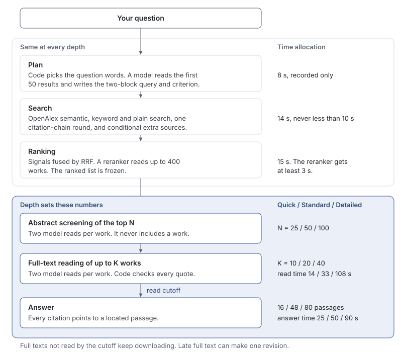
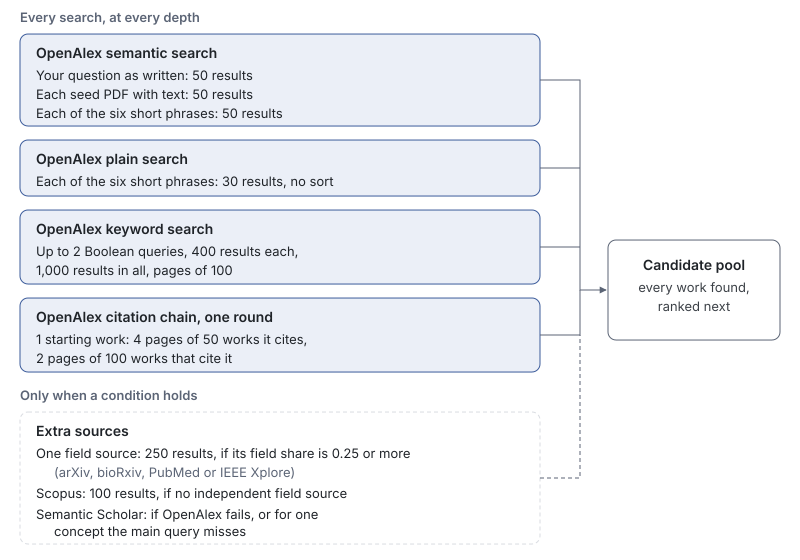
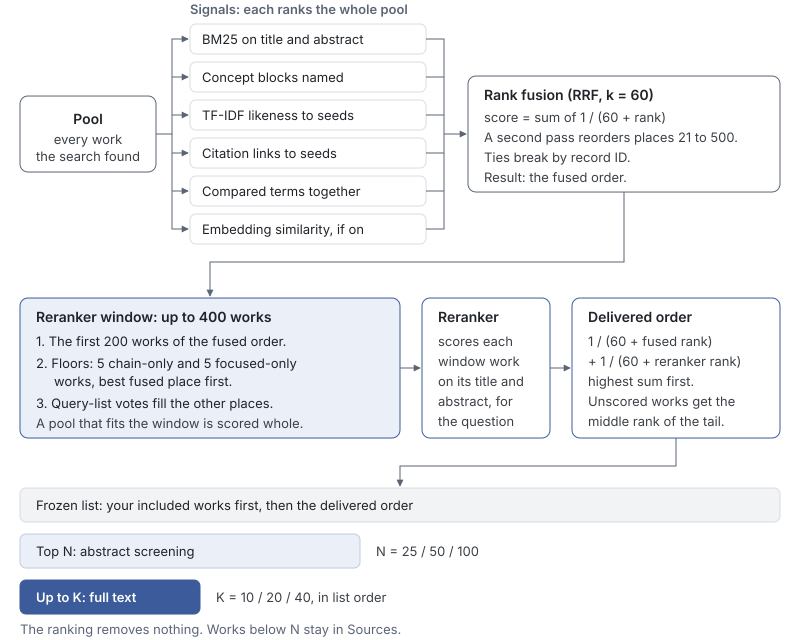

# How DEIXIS searches, ranks and reads

This page follows one question from the moment you send it to the cited answer. It describes the rules a new discovery run freezes: the run policy `fast_path_v1` with the shared search rule `uniform_search_v1`. The code is the exact rule, and the page says where each part lives. How well the ranking does on test sets is in [benchmark.md](benchmark.md).

A few words recur on this page:

- A **work** is one paper. A **record** is one copy of a work that a provider returned.
- The **pool** is every work the search found for one question.
- A **seed** is a work the run starts from: a PDF you attached, or a work you included yourself.
- **N** is how many works at the top of the ranked list get abstract screening.
- **K** is how many works the run aims to read in full text before it answers.

## The pipeline at a glance

A discovery run has five stages: plan, search, ranking, read and answer. The first three are the same at every depth. The depth you choose (Quick, Standard or Detailed) sets only how much the run reads and how long it may take to read and answer.

Each stage has a time allocation. Search, ranking and read stop when their own time runs out. The plan and answer allocations are only recorded: no plan step and no answer text is cut. Time a stage leaves unused carries over to the next stage. A stage that runs over takes no time from a later one. [Time and deadlines](#time-and-deadlines) gives the numbers.

A research whose sources are only your attached PDFs skips search and ranking. Its answer ranks the passages of those PDFs directly.

## Plan

The plan stage turns your question into search requests and an inclusion criterion. Code does every step that needs no judgement. A model does the rest.

1. **The question's own request goes first.** Code sends your question, as you wrote it, to OpenAlex semantic search for 50 results. No model and no translation is involved, so it starts before any planning step.
2. **Seed PDFs are matched.** You can attach up to five seed PDFs (rule `seed_pdf_v2`). Code matches each one to an OpenAlex work from the title on its first page, or from the DOI a library copy carries. Each seed with text also sends its own semantic request for 50 results.
3. **Code picks the question words.** These words come from your question. Code sends no query built from them. The ranking, the abstract stage's code rules and the protocol use them to know what the question itself asks.
4. **A model writes the search plan.** The model reads the results of the question's request: up to 50 records, with their titles, abstracts and OpenAlex keywords. From those records it picks the query terms and sorts them into two blocks, the setting and the task. A block holds at most four terms, and the query at most eight. Each block can also have up to three backup terms. Every term names the record, field and characters it came from. Code reads that text back and refuses the plan if the term is not there.
5. **Code checks the terms with counts.** Code counts each term on OpenAlex alone and together with the other block. A term that finds nothing alone is replaced by a backup. A term that finds nothing together with the other block stays, and the next backup that does find records is searched beside it.
6. **Code compiles the Boolean query.** The query asks for any setting term AND any task term. A quoted phrase of two or more words also gets its other number form, for example `"mixture of experts"` OR `"mixtures of experts"` (rule `phrase_number_v1`).
7. **The plan can name extra parts.** It can name up to two *focused* concepts that the two blocks cannot hold. Each one becomes its own query. A run sends at most two Boolean queries, and the main query is one of them. It also names the work the citation chain starts from.
8. **A model writes six short phrases.** A separate model call reads only your question and writes six phrases of three to seven words, worded as a title or abstract might word them. On a model that runs on your computer, this call is skipped, because such a model answers one call at a time and the plan would wait.
9. **A model proposes the inclusion criterion.**

A question that is not in English and has no English key terms gets one more model step. The model writes the question as one English sentence, and code picks the words from that sentence. An English sentence you saved for the question replaces the model's. If the translation fails, the run pauses and asks you for key terms. Only the steps that need English wait for it: the reranker, the BM25 question terms and the comparison signal.

Key terms you type, or a search plan you save, replace the model's query. If the model fails twice, or a block is left with no term that finds records, the run pauses.

If your question states years, such as "since 2020" or "2019-2024", code reads them from your words and freezes them in the run. A request whose route accepts a year filter carries the range to the provider. A route that accepts none, such as Scopus, IEEE Xplore or Semantic Scholar passage search, is searched without it. Its results outside the range stay in Sources but are not candidates: no signal ranks them and no stage reads them.

Before the keyword search sends anything, code freezes the **protocol**: the question, the criterion, the search plan, the years and the seed matches. The question's request, the seed requests and the phrase requests can go out earlier. Their results are recorded under that same frozen protocol.

## Search

The search stage sends every planned request and collects the results into the pool. The same routes run at every depth.

**OpenAlex** is the main index. It gets four kinds of request:

- Semantic search finds works by meaning. It gets your question, each seed PDF and each of the six phrases.
- Plain search uses OpenAlex's own relevance order. It reads titles, abstracts and the full text OpenAlex holds. Each phrase gets one page of 30 results with no sort setting.
- Keyword search runs the compiled Boolean queries. It reads titles, abstracts and OpenAlex keywords, not full text.
- Citation chaining starts from one work. It fetches works that work cites and works that cite it.

The chain starts from a matched seed PDF if there is one, else from the work the plan named. A linked work joins the pool only when a searched term stands in its title, abstract or OpenAlex keywords. Up to ten linked works that no term reaches join anyway, so the reranker can judge them. Chaining keeps running into the ranking stage and stops 5 seconds before the ranking deadline.

**Extra sources** run only when their condition holds:

- One field source (arXiv, bioRxiv, PubMed or IEEE Xplore) is searched when its fields hold at least a quarter of the main query's OpenAlex results. Code counts those results by the field of each work's main topic. A PubMed query also carries the MeSH subject headings that NCBI confirms for your terms.
- Scopus is searched as a second index when no independent field source is planned and a Scopus key is set. bioRxiv goes through OpenAlex, so it does not count as independent.
- Semantic Scholar gets one relevance search when no OpenAlex request brought a record and at least one failed for a technical reason, such as a timeout. An empty OpenAlex answer is not a failure. It gets one passage search when the plan named a concept that the main query's results do not carry. A passage it finds is a lead to a work. No answer can cite it.

The run records why each planned source was or was not searched. The Scopus sub-topic search and Semantic Scholar's bulk search are off: they read no records.

**Candidate embedding** is off unless you turn it on in Settings. When it is on, an embedding model embeds each record's title and abstract as it arrives, and the ranking gains an embedding signal.

**Missing abstracts** are looked up before the reranker runs. For works in the reranker's window that have a DOI and no abstract, the run asks Semantic Scholar, then Crossref, then Scopus when it is set up. This round covers at most 400 works within 8 seconds.

## Ranking

The ranking orders the pool. It removes nothing and decides nothing about relevance.

**Signals.** Each signal ranks the whole pool on its own:

- `bm25`: BM25, a standard word-match score that weighs rare words more, over title and abstract against the question words and the searched terms.
- `blocks`: how many of the query's concept blocks the title and abstract name.
- `tfidf`: text likeness to your seeds, from TF-IDF word vectors (word counts weighted by rarity). It needs seed PDFs or works you included.
- `graph`: citation links to seeds. Its seeds are the works you included, filled up to 15 with works from the top of the `bm25` and `blocks` fusion. Seed PDFs are added on top, and each work counts only the seed PDF nearest to it.
- `joint`: whether the compared terms appear together. It runs only for comparison questions.
- `embedding`: similarity to the question. It runs only when candidate embedding is on.

A signal that cannot run is left out, and the run records why. A work a signal cannot score is ranked last in that signal.

**Fusion.** Reciprocal rank fusion (RRF) combines ranks, not raw scores. Each work scores the sum of `1 / (60 + rank)` over the signals, and the highest sum comes first. A second pass then recomputes the citation signal from your seeds plus up to 30 leading works that have a reference list, and adds a signal for each work's cited-by count. It reorders places 21 to 500 only. The first 20 places keep their order. Ties break by record ID, so the same input always gives the same list.

**Reranker.** A reranker is a model that scores how well each work's title and abstract answer the question. The default is Voyage `rerank-3-lite`, and Settings can choose another one. It scores a *window* of at most 400 works, not counting works you included. When the pool fits the window, every work is scored. When the pool is larger, code fills the window in this order:

1. The first 200 works of the fused order.
2. Floors: five works only the citation chain found and five works only a focused query found, best fused place first.
3. Votes from the query lists for the other places.

A query list is the result list of one query on one route of one provider. Each list that is ordered by relevance votes. A work's vote is the sum of `1 / (60 + its place)` over the lists that hold it. A list sorted by date or citation count does not vote, and a citation link is not a list.

**Delivered order.** The reranker's scores do not replace the fused order. Each work gets the sum `1 / (60 + fused rank) + 1 / (60 + reranker rank)`, and the highest sum comes first. A work the reranker did not score gets the middle rank of the unscored works. A work with no abstract keeps its fused slot when its text can still arrive: it has an open PDF, a stored file, or a lookup that is still out. Other works without an abstract are scored on their title. This is rerank rule version 6.

The reranker gets the ranking time that is left, but never less than 3 seconds and never more than 180 seconds. So when less than 3 seconds of ranking time is left, it may run past the ranking cutoff. That extra time is not taken from the read stage. If it has no key, fails or runs out of time, the list keeps the fused order and the run records why. No other reranker is tried in its place.

**The frozen list.** Works you included come first, then the delivered order. The list is frozen with everything it was computed from, and `small_batch.replay` rebuilds it from that stored manifest, never from the live database.

## Reading

The read stage screens the top N works and reads up to K of them in full text.

**Abstract screening.** Code rules settle what the title and abstract already decide. A model then reads the other works in batches of 20, twice each. Screening can set a work aside or keep it as a candidate. It never includes a work, because inclusion needs a full-text read. When the reranker ordered the list, code does not set a top-N work aside only because it names neither block (rule `reranked_window_open_v1`). The run waits for these model reads up to 60 seconds after they can start, even past the read deadline.

**Full-text reading.** The run aims to read K works in full text, in list order. A work whose text cannot be found, or whose PDF is not confirmed to be that work, gives its place to the next one. Each full-text read is two model calls over mostly different passages, and code checks every quote against the text. A work is included without you only when a verified quote backs every core part of the criterion and the two reads agree. Reads that code cannot settle go to the screening queue for you.

**After the cutoff.** The read cutoff freezes the evidence the answer may use. Works chosen for full text whose download had not finished keep downloading in the background.

Your include or exclude choice outranks model and code at every step, and keeps its reason.

## Answer

For a question that asks for a report, an answer run starts on its own when discovery finishes. Other kinds of question end with a paper list, a study table or a statement check.

The answer reads what the cutoff froze: passages of included works, the closest works (read in full but not meeting the whole criterion), and the abstracts of screened candidates. Full-text passages are ranked by BM25 on the question words and searched terms, fused by RRF with the passages that match the criterion. The depth's passage budget is shared breadth first: the first passage of each included and closest work, then one abstract per candidate, then further passages. The budget does not grow with the number of works. A work it leaves without a passage is listed as left out. Only a work you included, or one a Screen more run you started admitted, always gets its first passage.

Each citation must point to an exact anchor in a passage the answer step was given. If repair fails, the result is an unverified draft, not a cited answer. An optional answer review gives another model's opinion and never changes the answer. Full text that arrives later can produce at most one revision. The earlier answer is kept.

## What the depth changes

Every depth runs the same search and the same ranking. The depth sets only these numbers:

- N, the works screened by abstract.
- K, the works read in full text.
- The answer's passage budget and how many closest works it reads.
- How many works the run may ask you to supply a file for.
- How many open-web full-text searches it may send.
- The read and answer time.

With no reranker settings saved, the reranker's window is 400 works at every depth. Saving the reranker settings also saves a pool factor, 8 unless you change it. That factor makes Quick's window 200 works (see [Ranking parameters](#ranking-parameters)).

## Parameters

These tables list the values a new discovery run freezes. The "how chosen" column says where each value came from. A pilot value is a starting number that no measurement has compared with others.

### Search requests

The same at every depth.

| Parameter | Value | Meaning | How chosen |
|---|---|---|---|
| Question's semantic request | 50 records | Results of OpenAlex semantic search for your question as written | OpenAlex's maximum per semantic request |
| Semantic request per seed PDF | 50 records | Results of OpenAlex semantic search for each seed's text | Same cost per request as the question's request |
| Short phrases | 6 | Phrases a model writes from the question alone | Pilot value. An offline replay of stored runs kept 6 over fewer |
| Semantic request per phrase | 50 records | Results of OpenAlex semantic search for each phrase | OpenAlex's maximum |
| Plain search per phrase | 30 records | One page of OpenAlex plain search, no sort | Offline replay: 30 did better than 50 |
| Keyword record cap | 1,000 records | All keyword requests of the run together | Pilot value |
| Records per keyword query | 400 | How far one Boolean query is read | Offline replay: places 401 to 650 found nothing no other request found |
| Keyword page size | 100 | Records per OpenAlex keyword page | OpenAlex's supported page maximum |
| Boolean queries | 2 | The main query plus at most one focused query | Pilot value. The focused query goes out only when needed |
| Compiled query limit | 8 | Most provider queries the plan may compile | Older Standard preset |
| Chain starting works | 1 | Works the citation chain starts from | Pilot value. Still open, needs a small live measurement |
| Backward chain requests | 4 pages of 50 | Works the starting work cites | Pilot value |
| Forward chain requests | 2 pages of 100 | Works that cite the starting work | Pages of 100 fetch the same citing works in fewer requests |
| Linked works kept without a term match | 10 | Chain results that join the pool although no searched term matches | Pilot value |
| Field sources | 1 | arXiv, bioRxiv, PubMed or IEEE Xplore beside OpenAlex | Pilot value |
| Records per field source | 250 | How many results the field source may read | Pilot value. Kept although a replay showed no loss without it, because the replay held no medicine or biology question |
| Field share needed | 0.25 | Share of the main query's OpenAlex results in the source's fields | Pilot value |
| Scopus second index | 100 records | Searched only when no independent field source is planned | Pilot value |
| Scopus sub-topic search | 0 (off) | A Scopus query for one uncovered part of the question | Off. It never sent a request in stored runs |
| Semantic Scholar bulk search | 0 (off) | A bulk keyword query to Semantic Scholar | Off. The bulk route has no relevance order |
| Semantic Scholar completion | 100 records | Relevance search when OpenAlex fails for a technical reason | Pilot value |
| Semantic Scholar passage searches | 1 | Passage search for a concept the main query's results miss | Provisional middle value |
| Rate-limit waits | 1 | How often a page, lookup batch or chain request waits out a provider's "too many requests" answer | Pilot value |

### Ranking parameters

The same at every depth unless the row says otherwise.

| Parameter | Value | Meaning | How chosen |
|---|---|---|---|
| Rank fusion | RRF, k = 60 | Each work scores the sum of `1 / (60 + rank)` over the signals | The usual RRF constant from the literature |
| Second pass | places 21 to 500 | Places the citation and cited-by signals may reorder. The first 20 stay | Built so the first 20 places never change |
| Reranker | Voyage `rerank-3-lite` | Default reranker when nothing is saved in Settings | Raised recall on two benchmarks against the fused order alone |
| Reranker window | 400 works | Most works one rerank scores | Our cap. A replay with whole-pool Voyage scores kept 400 |
| Window factor | 16 × N at Quick, 8 × N at Standard and Detailed | Window size before the 400 cap. Saving the reranker settings stores a factor (8 unless changed, at most 8), used up to the depth's own, so Quick then gets 200 | Gives 400 at every depth with nothing saved. 8 itself was not measured |
| Window places for the fused top | 200 | First places of the window, taken from the fused order | Chosen on stored runs |
| Window floors | 5 chain-only, 5 focused-only | Places kept for works with only one way in | Pilot value |
| Delivered order | `1/(60 + fused rank) + 1/(60 + reranker rank)` | How fused rank and reranker rank combine | Guards against reranker errors deep in the pool |
| Abstract lookups before the rerank | 400 works within 8 s | Window works with a DOI and no abstract that get a lookup | Hand-picked |
| Reranker time limit | 180 s | Longest one rerank may take | Default setting |

### Time

The plan, search and ranking times are the same at every depth. Read and answer times are in [Reading by depth](#reading-by-depth).

| Parameter | Value | Meaning | How chosen |
|---|---|---|---|
| Plan stage | 8 s | Recorded allocation. Nothing is cut | Pilot value |
| Search stage | 14 s | Search requests stop at this deadline | 90th percentile of stored search times |
| Search minimum | 10 s | The search stage never gets less than this from its own start | Measured keyword pages took 1.1 to 1.8 s each |
| Ranking stage | 15 s | Chaining, embedding, lookups and the reranker work inside it | 90th percentile of stored ranking times |
| Reranker allowance | 3 s | Least time the reranker gets, even when it must run past the ranking cutoff | 95th percentile of measured Voyage reranks over 400 works |
| Abstract-read ceiling | 60 s | Longest the run waits for the model's abstract reads of the top N | A ceiling against a hung call, not a measured need |

### Reading by depth

| Parameter | Quick | Standard | Detailed | Meaning |
|---|---|---|---|---|
| N | 25 | 50 | 100 | Works at the top of the list that get abstract screening |
| K | 10 | 20 | 40 | Works the run aims to read in full text before the cutoff |
| Answer passages | 16 | 48 | 80 | Passages the answer step is given |
| Closest works in the answer | 3 | 12 | 8 | Works read in full but not included that the answer may compare against |
| File asks | 0 | 3 | 5 | Works the research may ask you to supply a file for |
| Open-web full-text searches | 0 | 3 | 5 | Works the research may send a paid open-web search for |
| Read stage | 14 s | 33 s | 108 s | Read deadline |
| Answer stage | 25 s | 50 s | 90 s | Recorded answer allocation. Writing is not cut |

N, K, the file asks, the full-text searches and the stage times are pilot values. The passage budgets come from the older effort presets. Standard reads 12 closest works because 5 left out the two works a test question compared. The other depths' closest-work counts are not measured.

A Standard or Detailed run can also screen the next 100 works of the list once each (places 51 to 150, or 101 to 200). This deeper screening is off by default.

## Time and deadlines

The run measures time on your clock, from the moment you send the question. The time allocations above add up to two targets per depth:

| Target | Quick | Standard | Detailed |
|---|---|---|---|
| Handover to answer writing (plan + search + ranking + read) | 51 s | 70 s | 145 s |
| End-to-end target (handover + answer) | 76 s | 120 s | 235 s |

Both targets are recorded, and the run shows by how much it missed each one and why. Neither target cuts a stage. Each stage stops at its own deadline, counted from its own start (rule `evidence_minimum_v1`). Time the reranker uses past the ranking cutoff is not taken from the read stage, so the answer comes that much later.

A run on a model that runs on your computer keeps no read or answer deadline, no handover and no reranker allowance. Search and ranking keep their deadlines.

## Resume and frozen rules

A run keeps the rules it froze when you started it. The policy, with its hash, is frozen when the run is queued. The protocol, the search plan, the ranked list and the read cutoff are each frozen once and read back afterwards.

- Every step is a stored row with its own key. A step that succeeded never runs again.
- When the app starts, it marks steps that were half finished as "outcome unknown" and pauses their runs.
- You decide whether to resume a paused run. A model call that was in flight may then be sent again.
- A resumed run follows its own frozen rules, not the current ones.
- A run frozen under a rule this version no longer carries out stops on resume and names that rule. What it found stays. A new search runs under the current rules.
- Runs that you start yourself (Screen more, follow-up questions, snowball rounds, the citation map) never start on their own.

## Limits

- Ranks, embeddings, cited-by counts, reranker scores and model screening are priority signals. They are not relevance verdicts.
- A low place does not mean a work is irrelevant. It does not say whether an earlier run read the work.
- Found, screened, read in full, given to the model and cited are separate counts. A large pool says little about how much the run read.
- OpenAlex keyword search does not match full text. Only the plain phrase searches can match the full text OpenAlex holds.
- Code checks that each citation points to a located passage. It does not check that the passage supports the claim. The optional answer review is one more model's opinion.
- Deadlines make the results depend a little on provider speed.
- No search result proves that a question is new.

## Where it lives in the code

- [workflow/run/fast_path.py](../deixis/workflow/run/fast_path.py): stages, time allocations, `UNIFORM_SEARCH`, the per-depth `MODES`, the frozen policy
- [workflow/run/flow.py](../deixis/workflow/run/flow.py): run order, plan stage, translation, criterion, query compilation
- [workflow/search/search_plan.py](../deixis/workflow/search/search_plan.py), [workflow/search/search_query.py](../deixis/workflow/search/search_query.py), [workflow/search/vocabulary.py](../deixis/workflow/search/vocabulary.py), [workflow/search/english_question.py](../deixis/workflow/search/english_question.py), [workflow/search/protocol.py](../deixis/workflow/search/protocol.py): the model's plan, term counts, question words, translation, the frozen protocol
- [workflow/search/seed_match.py](../deixis/workflow/search/seed_match.py), [workflow/search/date_scope.py](../deixis/workflow/search/date_scope.py): seed PDF matching, the years a question states
- [workflow/search/search.py](../deixis/workflow/search/search.py), [workflow/search/routing.py](../deixis/workflow/search/routing.py), [workflow/search/completion.py](../deixis/workflow/search/completion.py), [workflow/search/mesh.py](../deixis/workflow/search/mesh.py): the search stage, field source and Scopus choice, Semantic Scholar completion, PubMed headings
- [workflow/search/phrase_search.py](../deixis/workflow/search/phrase_search.py), [workflow/search/fast_chain.py](../deixis/workflow/search/fast_chain.py), [workflow/search/fast_embedding.py](../deixis/workflow/search/fast_embedding.py): short phrase searches, citation chaining, candidate embedding
- [workflow/search/ranking.py](../deixis/workflow/search/ranking.py), [workflow/search/small_batch.py](../deixis/workflow/search/small_batch.py), [workflow/search/preselect.py](../deixis/workflow/search/preselect.py), [documents/rerankers.py](../deixis/documents/rerankers.py): signals, fusion, second pass, the reranker window and blend, the frozen list
- [workflow/search/lookups.py](../deixis/workflow/search/lookups.py), [providers/pacing.py](../deixis/providers/pacing.py): abstract lookups, Semantic Scholar pacing
- [workflow/read/read.py](../deixis/workflow/read/read.py), [workflow/screen/abstract_stage.py](../deixis/workflow/screen/abstract_stage.py), [workflow/read/adjudication.py](../deixis/workflow/read/adjudication.py), [workflow/read/background_fetch.py](../deixis/workflow/read/background_fetch.py), [workflow/screen/queue.py](../deixis/workflow/screen/queue.py): screening, full-text reading, background download, the screening queue
- [workflow/answer/answer.py](../deixis/workflow/answer/answer.py), [workflow/answer/late_revision.py](../deixis/workflow/answer/late_revision.py): answer input and passage budget, the late revision
- [providers/registry.py](../deixis/providers/registry.py): the scholarly sources DEIXIS can reach

## Older runs

A completed run keeps its stored list, screening and answer. A discovery run frozen before `uniform_search_v1` can be viewed but stops on resume, as do runs with `phrase_search_v1` or no phrase rule, rerank versions 1 to 5, lookup versions 1 to 4, or a reranker point of `after_list`. Those older rules covered depth-specific search limits, phrase requests, list windows and lookup behavior. A missing `search_plan_v1`, `fast_chain_v1` or `fast_chain_v2` also stops a discovery run; an answer allocation older than version 7 stops an answer run. The run names the removed rule when it stops. Start a new search to use the current rules.

Other stored differences remain visible where the run recorded them:
- **No `phrase_number_v1`:** quoted phrases get no other number form.
- **`seed_pdf_v1`:** one seed PDF, whose text joins the question's semantic request.
- **`block_terms_v1`:** one extra semantic request with the setting and task terms joined.
- **No `evidence_minimum_v1`:** the handover moment cuts the stages before the answer, and an earlier stage's overrun is taken from later stages.
- **No `rerank_allowance_v1`:** the reranker has only what is left of the ranking stage.
- **No `reranked_window_open_v1`:** abstract screening sets a top-N work aside for naming neither block, whatever ordered the list.
- **No candidate-embedding choice:** the run embedded candidates whenever Settings named an embedding model.
- **No handover rule:** stage deadlines alone.
