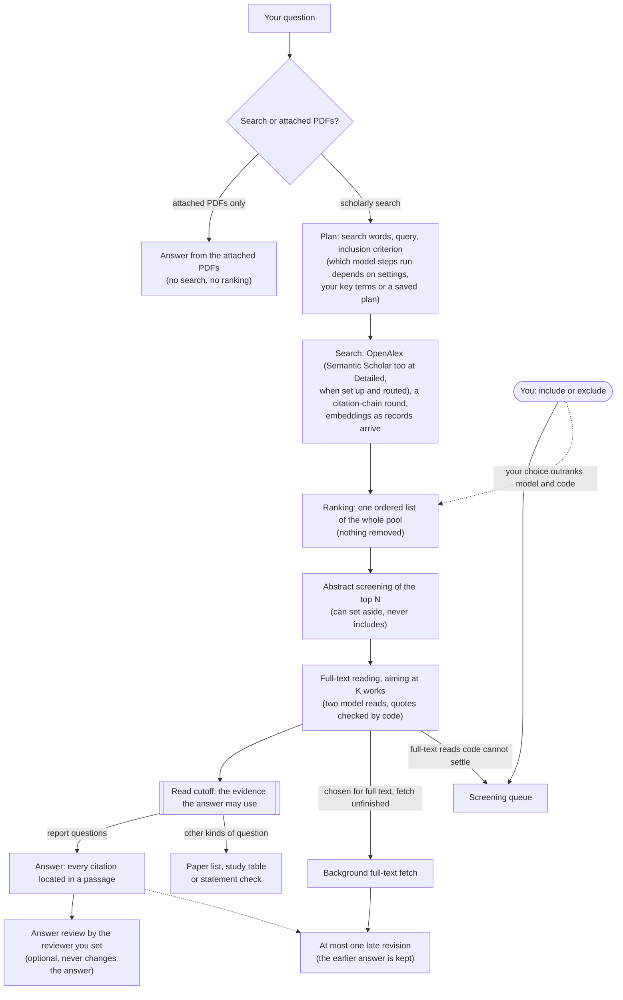
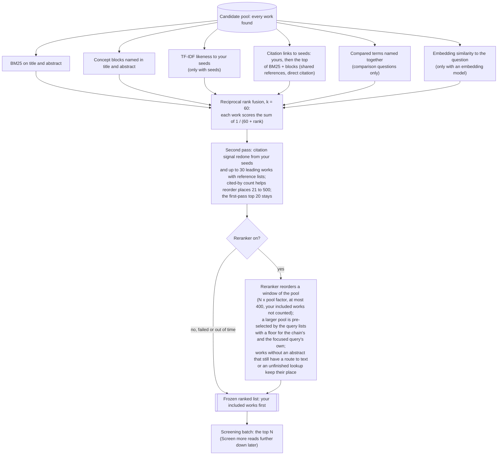

# How DEIXIS searches, ranks and reads

This page follows a question from the moment you ask it to the answer. It describes the current code (run policy `fast_path_v1`) for readers; the code is the exact rule. How well the ranking does on three test sets is in [benchmark.md](benchmark.md). Runs started under older rules keep the rules frozen with them; [Older runs](#older-runs) lists what differs.

A run has five stages: plan, search, ranking, read and answer. Each stage gets a time allocation. The time earlier stages left unused, or ran over, is added to or taken from the next stage's allocation. Search always gets at least its own allocation; ranking, read and answer never drop below a quarter of theirs. Over all of this sits the depth's own handover moment: 35 seconds at Quick, 1 minute 10 at Standard and 3 minutes 30 at Detailed, counted from the moment you sent the question, so the queue, the gaps between stages and any time the app spent stopped are inside it. When it arrives the run turns to writing the answer from whatever it has read, so no allocation and no overrun can push the first answer past the depth's end-to-end target of 1, 2 or 5 minutes. A run that stopped overnight and resumed has missed that target and gets no fresh window. Writing itself is never cut this way, because a cut there would leave you a draft instead of an answer, and a model running on your own computer keeps no handover at all. Only search, ranking and read stop at a cutoff when their time runs out. The plan and answer allocations are recorded and stop nothing. Every step is stored, and a step that succeeded is reused instead of being run again. After a crash or restart, steps that were in progress are marked "outcome unknown" and the run waits for you to resume it; a request that was in flight may then be sent again.

You decide in three places. Full-text reads the code cannot settle go to the screening queue, for example when a quote cannot be found in the text or the two model reads disagree. (At the abstract stage such cases keep the work as a candidate for full text instead.) Your include or exclude outranks any model or code decision and keeps its reason. Works you include go to the top of a later ranked list and act as seeds for the ranking. Screen more, follow-up questions, snowball rounds and the citation map start only when you start them.

## Where the search goes

The registry ([providers/registry.py](../deixis/providers/registry.py)) holds OpenAlex, Semantic Scholar, Crossref, arXiv, bioRxiv, PubMed, IEEE Xplore, Scopus, CORE and SerpApi. A discovery run searches OpenAlex. It sends one semantic request with your question as you wrote it, whatever its language (50 records), and one per seed PDF with text (25 records each), then keyword requests taken in turn across the queries until the record cap or the search deadline. OpenAlex keyword search covers a work's title, its abstract and the keywords OpenAlex's own classifier attaches to it, so a work can be found through a keyword that means the searched word without holding it; it does not cover full text. At Detailed depth one Semantic Scholar bulk request can add up to 500 records, when Semantic Scholar is among the research's sources and the plan routed a query to it; those 500 are kept back from the OpenAlex keyword records only when that request is really planned, and the run records why it sent none when it did not. Standard and Detailed also search one field source beside OpenAlex: of the sources the routing table names (arXiv, bioRxiv, PubMed, IEEE Xplore), the one whose fields hold the largest share of the question's records, and only when that share is at least a quarter. It may read up to 250 records, kept back from the OpenAlex keyword records the same way the bulk request's are. Quick searches none. Every other planned query is not sent, and the plan records why: another source's fields hold more of the question, the depth pays for no field source, the field distribution could not be read, no query was compiled for the source, or you left it out. Detailed depth pays for one more search beside that field source: a second index of its own, Scopus, which no part of the question chooses — the routing table does not name it, and it carries no field share. By default it is searched only where the run plans no independent field source, so a question whose records sit in one field is answered by that field's own index and a question spread across fields gets a broad index instead; a run whose only field source searches through another provider's host (bioRxiv, through OpenAlex) has no independent index of its own, and nor has a run whose field distribution could not be read, so both search it. It may read up to 100 records in pages of 25, kept back from the OpenAlex keyword records the same way the field source's are. The search asks Scopus for the record view that carries abstracts; a network without Elsevier's entitlement for that view answers with a refusal, which is recorded, and nothing is sent again. Why no second index was searched is recorded too: the depth pays for none, the run already planned an independent field source, Scopus is not one of the research's sources, it has no key, you left it out, or no query was compiled for it. Standard searches no second index of its own, but it pays for **one** search of that index all the same: after its field source has been read, if a part of the question the search plan named is still not carried by any record the main query or the field source brought, that part is asked of Scopus on its own, once, for 25 records. Those 25 are its own and are kept back from nothing: whether the request is sent is decided after the keyword requests have ended, so records taken off their cap would be lost on every question where nothing is sent, and a run that sends it reads 25 records more than one that does not. Four things are checked in code before a paid request is planned, and each is recorded when it fails: the depth really searches a field source (there is no "after the field source" otherwise), that source really answered (a source that brought no page leaves nothing to read the part against), the plan named a part at all, and that part is one your own question states — the plan's parts are a model's reading of the first page of results, and no money is spent on a sub-problem only the model inferred. Whether the part is still open is read after the field source's last page, so what that source found counts; if the records already carry it, nothing is sent and the run says so. Quick searches neither.

When that one field source is PubMed, its query carries the subject headings NCBI confirms for your words, where it confirms any. PubMed indexes its records under NLM's controlled vocabulary, so a record it has indexed can be about your concept without holding your term: "heart attack" is indexed as *Myocardial Infarction*. Before the plan is frozen, the run asks NCBI twice: PubMed's own term mapping names the heading of each term, asked for by a search that reads no article at all, and the MeSH database says whether that name is a descriptor of its own, which does read that descriptor's own vocabulary record for its preferred name and MeSH identifier. Only a heading both answers confirm is used, and it is written as an alternative — `term[Title/Abstract] OR "Myocardial Infarction"[MeSH Terms]` — never in place of the term, because a heading alone would lose the records NLM has not indexed yet. PubMed also searches the narrower headings under one, which the name check itself does not cover. The run records what was asked and what came back: each term NCBI did not map, each mapping of single words rather than the whole phrase, each name the MeSH database does not hold as a descriptor, and each heading a long query had no room for. Nothing claims the heading fits your question, and a failed or empty lookup leaves the query exactly as it was compiled.

Two further Semantic Scholar requests complete OpenAlex, each only in the state it is for, and each inside a record reservation taken off the keyword cap (50 in Quick, 100 in Standard, 200 at Detailed) so that the total a run reads does not change. The first: if **no** OpenAlex request brought a record and at least one of the requests that were sent failed for a technical reason — a refusal, a timeout, an unreadable answer — a short text from your question goes to Semantic Scholar's own relevance search in OpenAlex's place, and the answer's Methods box says which failure it was. OpenAlex answering with no record is a valid zero, not a failure, and sends nothing. The second: when the plan named a part of your question the main query's own records turn out not to carry, that part is also asked of Semantic Scholar's **passage** search, which looks inside full text — the concept and the main query's terms together, in one request (one in Standard, two at Detailed; Quick names no such part and waits for nothing). Finding a passage is not reading the full text: the passages are kept as what the provider said it found, with their kind and section, and never as a passage of the work, so no answer can cite one. The works those passages came from are looked up once by their Semantic Scholar id and join the pool like any other record; a work that lookup cannot reach leaves its passage with no record rather than losing it.

Some works near the top of the list lack an abstract. Semantic Scholar, Crossref and Scopus can be asked for one, when they are set up and allowed for the research; the number of lookups is bounded. When the reranker can run (its key is present, or the built-in model is ready), this lookup is first made for every work that has a DOI and no abstract among those the reranker will score: at most 400, within 8 seconds in all, or less when the ranking stage has less time left. Semantic Scholar gets one batch request first. Crossref follows, one work at a time with four requests out at once, then Scopus when it is set up and your network has access. If Semantic Scholar answers with a rate limit, it is not waited for: Crossref starts at once with the time left. A rate-limit answer also starts a cooldown (15 seconds, or the wait the service names, at most 60). During it, these lookups and the read stage's lookups send Semantic Scholar nothing, even requests already queued behind the refused one; they record each work as refused and ask Crossref and Scopus. Semantic Scholar requests are always at least 3 seconds apart.

A work still without an abstract keeps its place in the fused order only when text can still reach it: a version with an open PDF, a file stored for it, or a lookup request that went out for it (its own request headers were written to an open connection) and whose answer had not come back when the time ran out. A request that never went out before the time ran out (still queued, waiting for a connection or a proxy tunnel, or waiting to retry after a rate limit) does not count, and neither does one sent through a connection that reports no such event, since it cannot be shown to have gone out. Without a route to text, the reranker scores the work on its title, like a work every source answered without an abstract. The read stage fetches full text for candidates before works the abstract stage left unresolved (no abstract found, or two reads that settled nothing); your own works stay first. It then asks about the top N without asking a source about a work twice.

## How the query is built

Your question's own semantic request goes out before any of this: it carries your sentence as you wrote it, so it needs no translation and no model call, and everything below runs while it is in flight.

Code picks the search words from your question. Code does not translate: for a question that is not in English and has no English key terms, a model writes it as one English sentence and code picks the words from that sentence. That sentence is written while the first request is already out, and only what needs English later waits for it: the reranker, the question's words in the passage ranking and the comparison signal. Your own English sentence for the question is used instead when you saved one. If the translation fails, the run still has no words to build a query from, so it pauses and asks for key terms.

Code then counts the candidate phrases and their distinctive words on OpenAlex (at most 40 counts, four at a time). It drops phrases that find nothing and narrows a term from its root word to the whole phrase while the term finds more than 5,000 works. A model sorts the words into concept blocks in three separate calls; a block assignment needs two of the three to agree, and when fewer than two calls give a valid answer the code's own blocks stand. This step is skipped when you typed key terms, saved a plan, or the question gives no phrases or more than 40.

Another model call writes the keyword query: at most 8 terms, at most 4 per block, each block with the common synonym, variant or abbreviation of its main term when authors use one, and up to 3 backups per block. Code counts each term alone and together with the other block, four counts at a time. A term that finds nothing alone is replaced by a backup. A term that finds records alone but none together with the other block stays, and the next backup of its block that does find records with the other block is searched beside it, as long as the query stays within 8 terms. The plan records why each backup was used. The model is not asked when you typed key terms or when you saved a search plan. A query already written for the same question revision is reused when it was written under the same search method and with the same seed excerpts. The model call gets two attempts; if both fail, or the answer leaves a block with no term that finds records, the run pauses. Nothing is searched in its place: code builds no keyword query of its own, so the way on is a new question or key terms you type. A search plan you saved replaces the model's query.

The words code picked from your question are not searched as a query of their own. They are kept beside the model's terms and read where the run judges records rather than asks for them: the lexical rules of the abstract stage, which set a work aside only when neither your question's words nor the query's stand in its title or abstract, and the ranking's own signals. Model calls propose the inclusion criterion unless a saved plan sets it or one is already frozen for the same question. A plan a model wrote is frozen with a fingerprint of what wrote it: the hash of everything the call was sent, as it was sent — your question and each record's title, abstract and provider keywords, in the order it read them — beside the hash of the plan rule, the answer's schema, the instruction package and the model asked, its effort and the model that answered. Two plans with the same fingerprint were written from the same reading by the same writer, so their terms can be compared; the fingerprint changes nothing a run searches for. The protocol, with its search plan, is frozen before the search stage sends its requests. Two requests go out before it, as they need nothing it holds: each seed PDF's match and your question's own semantic request. Their pages are recorded under the one frozen protocol.

## Seed PDFs

You can attach up to five seed PDFs. Before the query is planned, each is matched to an OpenAlex work from its first page (the second page when the first has no text). A match needs the work's title, at least four words long, within the first 1,500 characters, and only one work that fits; a DOI printed in the PDF is not enough on its own. A PDF that came from Zotero or your library with its own DOI is matched by that DOI when the record's title stands in the same place. The match is frozen in the protocol. The query writer reads each seed's excerpt, each seed with text sends its own semantic request, and matched seeds become the first citation-chain seeds. In the ranking, seed PDFs and works you included are the seeds for the TF-IDF signal and the first seeds for the citation signal; for the citation signal, each work counts only the seed PDF nearest to it.

## Citation chaining and embeddings

While the keyword pages arrive, one round of citation chaining runs on OpenAlex. Its seeds are the matched seed PDFs, then works the semantic request returned. Backward requests fetch works the seeds cite and forward requests fetch works that cite them; how many depends on the depth: Quick opens no citation request of its own, Standard chains from one starting work and Detailed from at most three, both directions at once. Links that cost nothing are written at every depth, Quick included: each record of the first semantic page arrives with its own bibliography, so where that page holds both A and B and B's bibliography names A, B cites A and the link is recorded without asking for anything. If the round has fewer seeds than the depth allows when the search stage closes, the pool is ranked at that moment and the gap is filled from the top. A linked work joins the pool only when a searched setting or task term stands at a word start in its title, its abstract or one of the keywords OpenAlex's own classifier gave it; each keyword is read on its own, and the records a request returns are capped before this check, so reading the keywords widens what passes without fetching more. Under the `m2` search method a few of the linked records that no term reaches join the pool all the same, in the order the provider returned them, so the reranker judges them against the question itself; how many is frozen in the run (five at Standard, ten at Detailed, none at Quick), and the word check's own verdict on them is still recorded. At the same time, where you turned candidate embedding on, an embedding model (Gemini, OpenAI, Voyage, Cohere, Ollama, LM Studio or a built-in model) embeds each record's title and abstract as it lands; it is off unless you turn it on, because the reranker reads titles and abstracts as text and needs no embedding, and a run left with it off records that its embedding signal was left out. The choice is read when the run is queued and frozen in it. Chaining and embedding stop 5 seconds before the ranking deadline, and a record not embedded by then gets no embedding score.

## Ranking

The ranking sets the order in which works are read. The ranking itself removes nothing and decides nothing.

Each signal ranks the whole pool on its own, and the ranks are fused, never the raw scores. The citation signal does not need your seeds: after yours, its seed list is filled up to 15 works from the top of the BM25 and block fusion. A signal that cannot run (TF-IDF without seeds of yours, the citation signal when no seed has a reference list, not a comparison question, no embedding model) is left out and the run records why. A work a signal cannot score (TF-IDF without an abstract, the citation signal without a reference list) is ranked last in that signal but still counts. Ties are broken by record id, so the same input always gives the same list. Everything the list is computed from is stored with it, and the list is rebuilt from those stored inputs rather than from the live database.

The second pass recomputes the citation signal from your seeds plus up to 30 of the best-placed works that have a reference list, with a seed's citation of a work counting double. When none of those seeds has a reference list, the first citation signal stands. It then adds a signal from each work's cited-by count and reorders places 21 to 500 over all signals, with the citation and cited-by signals counting double. The first pass's top 20 stays in front, even when the second pass would lift another work above them.

The reranker is on by default (Voyage `rerank-3-lite`; without a Voyage key nothing is sent and the fused order stands). It scores a window of the pool, not counting works you included: N times this depth's own factor, rounded up, and at most 400 — eight times N at Standard and Detailed (400 at both), twice N at Quick (50). A pool factor you saved in Settings is used up to the depth's own. At Quick depth the list does not wait for the reranker: it is frozen from the fused order first and the reranker then reads its small window, so its scores are kept as a record of what it would have said and no work moves; the research says so. Standard and Detailed freeze the list after the reranker has read its window, so there the scores decide the order and the read cutoff. The lookup for missing abstracts before the rerank runs only at those depths. When the pool is larger than that window, which works go into it is decided by the query lists themselves rather than by the fused order. Each relevance-ordered list of one query of one provider votes, a work's score is the sum of `1 / (60 + its place)` over the lists that hold it, and the window is filled from the highest sum down, the places left over going to the fused order itself. One query is one list however many pages it took and however often it was resent, so a work is counted once, at the first place that list gave it; a list a provider ordered by date or citation count casts no vote, and a citation link is no list at all, so chaining votes for nothing. Because a work three middling lists hold outscores a work one list puts first, the window keeps a floor for the works with one way in and no votes to spare: at least five works only citation chaining found and five only a focused query found, the best placed of them in the fused order. Those places are kept before anything else is filled, so neither floor can be crowded out by the votes or by the other floor. A work found by a second query counts as having a second way in even when that query's list cast no vote. The pre-selection decides only who enters: the window's own order is the reranker's, the works it never read keep their fused order after them, and a pool that fits the window is not pre-selected at all. Works in that window that only chaining found are scored like the others. Works without an abstract that have a route to text or an unfinished lookup keep their place (see [Where the search goes](#where-the-search-goes)); other works without an abstract are scored on their title. The list stores which works were kept and why. The reranker reads only the question and each work's title and abstract. It has 180 seconds or the ranking time left, whichever is shorter. If it fails or runs out of time, the list keeps the fused order and no other reranker is tried.

## Reading

The discovery run screens the top N of the frozen list. The abstract stage reads works in batches of 20, each read twice by the model, after code settles what title and abstract already decide. It can set a work aside or keep it as a candidate; it never includes one, because inclusion needs a full-text read. The run then aims to read K works in full text, in list order. K is a target, not a hard limit: a work already claimed for full text keeps its slot, so the count can end above K, and a work whose text cannot be found, or whose PDF is not confirmed to be that work, gives its slot to the next one. Full-text adjudication asks the model twice, mostly over different passages, and code checks every quote against the text. A work is included without you only when every core part of the criterion is backed by a verified quote, the two reads do not contradict each other, and its title does not name a study protocol; code never excludes a work on a comparison part of the criterion. Works chosen for full text whose fetch had not finished at the cutoff keep being fetched in the background. You are asked about at most two works per question version: the cutoff freezes the first two open rows of "Waiting for your decision", and answering one never brings up the next; the others stay listed, not asked. If you decide a work while the run reads, the run keeps going and never writes over your choice; a screening decision you record also keeps that work from being sent to the model again.

Deeper screening (not offered in the app yet): a Standard or Detailed run queued with this option on also screens the next 100 works of the frozen list (Standard 51–150, Detailed 101–200), in batches of 20 read once each, after the top N. K, its order and the fetch queue do not change; only the answer's window widens, so a work the extra window keeps as a candidate can reach the answer from its abstract alone and is never included because of it. A work in that window not screened by the cutoff stays out of the answer. The option is frozen into the run when it is queued, and a later run reads a once-read work twice again. Settings does not show it until its validation run passes; only the preferences API can turn it on.

## The answer

For a question that asks for a report, an answer run normally starts on its own when the discovery run finishes; other kinds of question end with a list of papers, a study table or a statement check instead. The automatic answer reads what the cutoff froze: full-text passages of included works, the closest works, and the abstracts of screened works that are still candidates.

The standard depth reads 12 of them because 5 was too few: on the frozen 8 November cuts the two works the question itself compared stood sixth and seventh among the closest works, so both were left out of the answer. The numbers for the other depths are unmeasured.

A closest work is one whose file was read in full and that did not meet the whole criterion; it is never counted as included. On a question whether something has been done, these are the works the answer compares against, so it reads at most 3, 12 or 8 of them (quick, standard, detailed). They are taken by how many criterion parts their reading found (a verified quote counts before an unverified one, a disputed part not at all), list order breaking ties. A closest work whose reading found no part of the criterion is left out, with one exception: one place goes to the first such work in list order that its abstract screening made a candidate, unless you excluded it or late full text excluded it. It stays a closest work, its reading's decision is unchanged, and the answer input marks why it was taken. The late revision does not use this exception yet. Each closest work is read from at most four passages: its abstract, then the pages its reading quoted, then other pages that match the question. It is told what the reading found of each criterion part, never the reading's own wording.

An answer you start later can also use works you included since, candidates from Screen more, and snowball candidates once you include them. If you include or exclude a work while an answer is being written, that answer still finishes from the selection it started with and is marked out of date, and a new answer from your current selection starts after it.

Full-text passages are ranked by BM25 on the question's words and the searched terms, fused (RRF) with the passages that match the criterion; there is no semantic passage search here. Passages that report results, and formula passages on a formula question, can be moved up. The passage budget (16, 48 or 80) is shared by role, breadth first: the first passage of every included and closest work, then one abstract per candidate read from its abstract alone, then the rest of each closest work (at most 4 in all; at most 2 for the closest work taken although its reading found no criterion part), then the deeper passages of included works (at most 6 in all). The budget does not grow with the number of works. A work it leaves without a passage is listed as left out, with that reason; only a work you included, or one a Screen more run you started admitted, always gets its first passage, even past the budget. A citation must be located in a passage the answer step was given, or the answer stays an unverified draft.

If background full text arrives later, it can produce one revision. The revision takes every work the late reading includes, and works the late reading makes closest works (with at least one criterion part found) while the earlier answer has closest places left; a new closest work also needs a passage the earlier answer left free. Without either, no revision is made. The attached-PDFs-only path skips search and ranking: the answer ranks the PDFs' passages by keyword match (and by meaning, when an embedding model is set), and a short single PDF can go in whole.

The Evidence table a research answers with is opened by the discovery run itself, in the ranking stage, before it reads a single paper. Two columns are written by code from the question — what the source reports for it, and the condition that finding holds under — so the table is never without columns, and one model call then proposes more, framed by the ranked works' abstracts. That call is optional: when it fails the reading goes on with the two columns. The call is made before the reading clock starts, so it spends none of the reading time. A research that asks only for a list of papers opens no table.

A paper's findings reach the table as that paper is read. Once a work's full text has been read and judged, the run asks one model call for that source's still-empty columns, beside the readings that are still out. Those calls are sent only from the model-call allowance the reading no longer needs: what the remaining readings and the unclosed batches of the deeper screening still owe is held back first, and they have their own two places to send from, so a cell call never waits in the queue the readings use nor holds one of its places. Nothing new is asked after the read deadline, and a call whose text was still being chosen when the deadline passed is closed unsent. A call already sent is never cut: it is owned apart from the run, so the first answer waits for no table work, and its cells land in the table after that answer — in the next frozen view, not the one the answer rests on. Only a paper this run read is asked about, and only about the version its reading plan opened: a record judged from its title, one whose file could not be confirmed as its own, one never fetched and one read on another of its versions get no cell this way. A failed cell call costs that paper's cells and nothing else. What is left is filled by the ordinary fill after the answer.

When an answer's input is settled, the run freezes one view of the Evidence table as that answer's evidence: its rows are the answer's own sources, each row gives the text the answer read for it — the pages when it read the file, the abstract when it read the abstract — and a cell's quote that falls outside its row's text is counted as located but unverified. Reading depths and the counts the report states are taken after those narrowings. A report of that answer is written from this view, so a full text that arrives later cannot reach the report without first reaching an answer; a late revision freezes its own view, and the earlier one stays readable as it was.

When a question's answer is written up as a report, the report plan ties each sub-question the question asks for — a comparison, a condition, a criterion — to one column of the Evidence table. Before the sections are written, the run records how many rows answer each sub-question with a located quote, how deep those rows were read, and which sub-questions have no such row at all; that record is read beside the report, and changes nothing the sections may cite.

The structural checks that follow a finished report no longer cost the same. A warning (an equation read by OCR, say) changes nothing. A finding confined to one claim — the quote its citation names was not found in the evidence that claim was given — has that claim's citations read once more; if the quote is still not there, the claim is delivered with its uncertainty reported on the report screen and the rest of the report stands. Every other finding (a count that differs from the frozen corpus, a word budget, a malformed stored record) still refuses the report, and so does a conclusion with no claim at all or with one whose basis is gone: the conclusion is where the report answers the question, nothing stored says which of its sentences carries that answer, so a report whose conclusion is not wholly supported is a draft, not a report.

## Depth numbers

Frozen into each run when it starts. Stage times, N, K, chain seeds, the record cap and the reranker's window and run point come from `MODES` in [fast_path.py](../deixis/workflow/run/fast_path.py); the Detailed split of the record cap is in [search.py](../deixis/workflow/search/search.py), the reranker window in [rerankers.py](../deixis/documents/rerankers.py) and the answer passage budget in [rules.py](../deixis/domain/rules.py). Only search, ranking and read apply a cutoff; plan and answer time is recorded, not enforced. A run on a model that runs on your own computer (Ollama or a local server) has no read cutoff; search and ranking keep theirs.

| | Quick | Standard | Detailed |
|---|---|---|---|
| Stage time allocations, plan / search / ranking / read / answer (s) | 30 / 30 / 30 / 60 / 30 | 30 / 45 / 60 / 120 / 45 | 45 / 90 / 120 / 270 / 75 |
| Works screened by abstract in the run (N) | 25 | 50 | 100 |
| Full-text target (K) | 10 | 20 | 40 |
| Works the reranker scores (the depth's own window; a factor you saved is kept under it) | 50 | 400 | 400 |
| When the reranker runs | after the list is frozen (it orders nothing) | before the list | before the list |
| Keyword records, at most (counted by page size requested) | 450 | 1,000 | 2,000 in all, of which 500 are kept for Semantic Scholar when a bulk query is planned and the rest are the keyword queries' to use. The figure is a ceiling, not a promise: one query reads at most 1,000 records, and a completion request planned for this run is kept back from the same 2,000. |
| Citation-chain starting works, at most | none | 1 | 3 |
| Linked records kept although no term reaches them (`m2` only) | none | 5 | 10 |
| Answer passage budget | 16 | 48 | 80 |

## What the benchmark measures

The score in [benchmark.md](benchmark.md) is recall@k: the share of a question's gold papers (chosen by experts or survey authors) found in the first k places of the ranked list, averaged over questions. The benchmark page explains its date filtering and how failed questions count. It measures search and ranking only. Screening, full-text reading and answers are not scored.

## Limits

- Ranks, embeddings, cited-by counts, the reranker and model screening are priority signals, not relevance verdicts. A low place is not a judgement that a work is irrelevant, and it says nothing on its own about whether the work was read (an earlier run may have read it).
- Found, screened, read in full, given to the model and cited are separate counts, and each work keeps its reading depth (metadata, abstract, passage, full text). A large pool says little about how much was read.
- Search goes to OpenAlex; to Semantic Scholar at Detailed depth when it is set up and routed, and to its relevance or passage search when one of the two states above is observed. The OpenAlex keyword search reads titles, abstracts and OpenAlex's own keywords; it does not match full text.
- Code checks that each citation points to a located passage. It does not check that the passage supports the claim; the optional answer review is one more model's opinion.
- Deadlines make results depend a little on provider speed, and no search result proves a question is new.

## Older runs

A run keeps the rules frozen when it started. The ones still met on resume:

- **Before the 6 November rules:** the closest-work exception does not apply.
- **Reports written before the finding scopes:** any structural error refuses the whole report, and a conclusion sentence without a located basis is not itself an error.
- **Rerank rule version 1, with the first lookup rule:** the default pool factor is 4 (and a saved one is used up to 4); every work without an abstract is scored on its title; only the first 20 such works are looked up, within 5 seconds.
- **Rerank rule version 2, with lookup rule version 2:** every work left without an abstract keeps its place, and Semantic Scholar is waited for as the depth allows. Plans frozen under `block_terms_v1` also send a second semantic request with the setting and task terms joined (new plans do not: in the 6 November pilot it added 113 works and no reference paper).
- **Answer allocation version 6 and earlier:** the standard passage budget reads 5 closest works, not 12.
- **Answer allocation version 5 and earlier:** an answer gives the closest works their further pages before the candidates' abstracts, and the exception's closest work up to 4. Under lookup rule version 3 a work also keeps its rerank place when a source that was to be asked about it had not answered, whether or not the request went out.
- **Lookup rule version 4:** Crossref has eight requests out at once instead of four (version 5 is back to four).
- **Rerank rule version 4 and earlier:** the reranker's window is the leading works of the fused order itself. The query lists cast no vote, so there is no floor for the works only citation chaining or only a focused query found.
- **Rerank rule version 3 and earlier:** works in the reranker's window that only chaining found keep their place and are not looked up before the rerank. An offline replay of the 18 October BioASQ and LitSearch runs showed this hold cost about 3 points of recall at 50.
- **First seed-PDF rule (`seed_pdf_v1`):** one seed, whose text is added to the question's semantic request.
- **Before the depths had a reranker window of their own:** every depth scored N times eight works (200 at Quick) and every depth's list waited for the reranker, Quick's included.
- **Before candidate embedding became a choice:** a run embedded its candidates whenever Settings named a semantic-search model, so its ranking had an embedding signal without being asked.
- **Candidate embedding, on** (not an older rule, but off by default): with it on, the run embeds each record's title and abstract as it lands and the ranking gains the embedding signal. The choice is frozen in the run, so a resumed run ranks the way it was queued.
- **The abstract stage's word check, off** (not an older rule, but off by default in the other direction: the check is on unless a run was queued with it off): with it off, code sets no work aside for naming neither block and every record the read limit reaches is read by a model. The arm is frozen in the run, so a resumed run screens the way it was queued and the two arms can be compared over the same pool.
- **`m1` search method** (not an older rule, but off by default; only the owner's answer-quality measurement selects it): chaining admission splits hyphens and slashes, reduces plain plurals and uses every setting and task term the query step wrote, unused backups too; these terms are frozen in the protocol.
- **`m2` search method** (off by default in the same way): everything `m1` changes, the chain's rescue quota above, and the search plan is written by one model call *after* the question's own semantic page comes back. The model reads those records — their titles, the abstracts the page carried and OpenAlex's own keywords — and every term it gives names the record, the field and the characters it was read from; code reads that span back from the text it sent and refuses the answer when the phrase is not there, backups included. The same call names one to three works the citation chain starts from, and those are the only works it starts from. The three block-labelling calls and the query call of the other methods are not made, so the plan costs one call instead of four. A page that brought back no record stops the run rather than writing a query from the question alone, and a forward citation allowance left over is spent on the next page of the same work instead of a work the plan did not name. The same call may name up to two *focused* concepts: a concept the records show, that the question needs and that the two blocks cannot hold, because the main query asks for a setting term and a task term together. Each one is searched as its own query — the concept AND the main query's terms joined by OR — and counts against the depth's query budget, which is one plan on Quick, two on Standard and three on Detailed; the main query spends one of them. A focused query is not sent when the main query's own first page already carries the concept in the records' own words, and the step records the concept with the reason it sent nothing.

## Where it lives in the code

- [workflow/run/fast_path.py](../deixis/workflow/run/fast_path.py): stages, time allocations, depth numbers
- [workflow/run/flow.py](../deixis/workflow/run/flow.py): plan stage and run order, translation, concept blocks, criterion, read-stage lookups, attached-PDF answer
- [domain/vocabulary.py](../deixis/domain/vocabulary.py), [workflow/search/vocabulary.py](../deixis/workflow/search/vocabulary.py), [workflow/search/search_query.py](../deixis/workflow/search/search_query.py), [workflow/search/english_question.py](../deixis/workflow/search/english_question.py), [workflow/search/protocol.py](../deixis/workflow/search/protocol.py), [workflow/search/plan_identity.py](../deixis/workflow/search/plan_identity.py): question words, counts, the model's query, the frozen protocol, a plan's fingerprint
- [workflow/search/seed_match.py](../deixis/workflow/search/seed_match.py): seed PDF matching
- [workflow/search/search.py](../deixis/workflow/search/search.py), [workflow/search/fast_chain.py](../deixis/workflow/search/fast_chain.py), [workflow/search/chaining.py](../deixis/workflow/search/chaining.py), [workflow/search/fast_embedding.py](../deixis/workflow/search/fast_embedding.py): search stage, citation chaining, embeddings
- [workflow/search/ranking.py](../deixis/workflow/search/ranking.py), [workflow/search/small_batch.py](../deixis/workflow/search/small_batch.py), [workflow/search/preselect.py](../deixis/workflow/search/preselect.py), [documents/rerankers.py](../deixis/documents/rerankers.py): ranking, second pass, the reranker's window, lookups before the rerank, the frozen list
- [workflow/search/lookups.py](../deixis/workflow/search/lookups.py), [providers/pacing.py](../deixis/providers/pacing.py): abstract lookups, Semantic Scholar spacing and cooldown
- [workflow/read/read.py](../deixis/workflow/read/read.py), [workflow/screen/abstract_stage.py](../deixis/workflow/screen/abstract_stage.py), [workflow/read/adjudication.py](../deixis/workflow/read/adjudication.py), [workflow/read/background_fetch.py](../deixis/workflow/read/background_fetch.py), [workflow/screen/queue.py](../deixis/workflow/screen/queue.py): reading, background fetch, the screening queue
- [workflow/answer/answer.py](../deixis/workflow/answer/answer.py), [workflow/answer/late_revision.py](../deixis/workflow/answer/late_revision.py): answer input and passage budget, late revision
