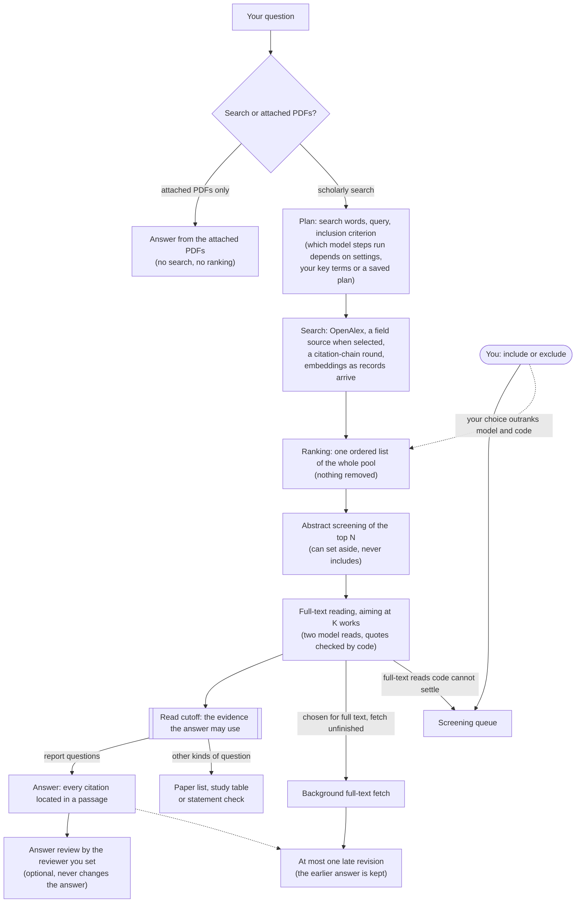
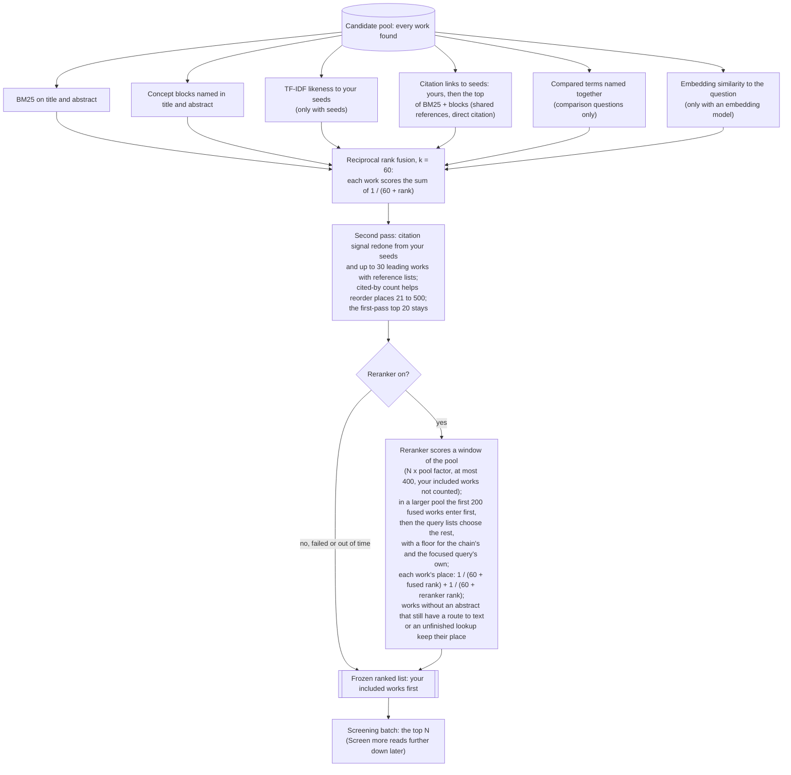

# How DEIXIS searches, ranks and reads

This page follows a question from the moment you ask it to the answer. It describes the current code (run policy `fast_path_v1`) for readers; the code is the exact rule. How well the ranking does on three test sets is in [benchmark.md](benchmark.md). Runs started under older rules keep the rules frozen with them; [Older runs](#older-runs) lists what differs.

A run has five stages: plan, search, ranking, read and answer. Each stage gets a time allocation. The time earlier stages left unused is added to the next stage's allocation; time an earlier stage ran over is not taken from a later one, so every stage gets at least its own allocation (see [The evidence minimum](#the-evidence-minimum)). Over all of this sits the depth's own handover moment: 51 seconds at Quick, 1 minute 10 at Standard and 2 minutes 25 at Detailed, counted from the moment you sent the question, so the queue, the gaps between stages and any time the app spent stopped are inside it. When it arrives the run turns to writing the answer from whatever it has read; a run under the evidence minimum instead lets every stage finish on its own deadline and waits for the search stage's minimum and the model's reads of the top N abstracts. So a run whose plan ran long answers later than the depth's end-to-end target of 1 minute 16 seconds, 2 minutes or 3 minutes 55 seconds, and records by how much and why. A run that stopped overnight and resumed has missed that target and gets no fresh window. Writing itself is never cut this way, because a cut there would leave you a draft instead of an answer, and a model running on your own computer keeps no handover at all. Only search, ranking and read stop at a cutoff when their time runs out. One step keeps time of its own past a cutoff: the reranker (see [Ranking](#ranking)). The plan and answer allocations are recorded and stop nothing. Every step is stored, and a step that succeeded is reused instead of being run again. After a crash or restart, steps that were in progress are marked "outcome unknown" and the run waits for you to resume it; a request that was in flight may then be sent again.

You decide in three places. Full-text reads the code cannot settle go to the screening queue, for example when a quote cannot be found in the text or the two model reads disagree. (At the abstract stage such cases keep the work as a candidate for full text instead.) Your include or exclude outranks any model or code decision and keeps its reason. Works you include go to the top of a later ranked list and act as seeds for the ranking. Screen more, follow-up questions, snowball rounds and the citation map start only when you start them.

## Where the search goes

The registry ([providers/registry.py](../deixis/providers/registry.py)) holds OpenAlex, Semantic Scholar, Crossref, arXiv, bioRxiv, PubMed, IEEE Xplore, Scopus, CORE and SerpApi. Every new discovery run uses the same search limits. OpenAlex receives your question as written (50 semantic records), each seed PDF with text (50 semantic records), and six short phrases (50 semantic and 30 plain-search records each). Keyword queries read up to 400 records each in pages of 100, within a shared cap of 1,000. OpenAlex keyword search covers titles, abstracts and OpenAlex keywords, not full text. The plain phrase search can match full text OpenAlex holds. The plan may send two Boolean queries, within eight compiled provider queries. A run also starts one OpenAlex citation chain.

One field source may join OpenAlex: arXiv, bioRxiv, PubMed or IEEE Xplore, whichever has the largest share of the question's records, provided that share reaches 0.25. It may read 250 records. Scopus can read 100 records as a second index when no independent field source was planned. If the field source is bioRxiv through OpenAlex, it is not an independent index, so Scopus remains eligible. A Scopus request needs a key and access to the abstract-bearing view; a refusal is recorded. The Scopus sub-topic search and Semantic Scholar bulk search are off in new runs. A planned completion, field-source or Scopus reservation comes off the 1,000-record keyword cap; an unused reservation does not. The plan records why an eligible source was not sent.

When that one field source is PubMed, its query carries the subject headings NCBI confirms for your words, where it confirms any. PubMed indexes its records under NLM's controlled vocabulary, so a record it has indexed can be about your concept without holding your term: "heart attack" is indexed as *Myocardial Infarction*. Before the plan is frozen, the run asks NCBI twice: PubMed's own term mapping names the heading of each term, asked for by a search that reads no article at all, and the MeSH database says whether that name is a descriptor of its own, which does read that descriptor's own vocabulary record for its preferred name and MeSH identifier. Only a heading both answers confirm is used, and it is written as an alternative — `term[Title/Abstract] OR "Myocardial Infarction"[MeSH Terms]` — never in place of the term, because a heading alone would lose the records NLM has not indexed yet. PubMed also searches the narrower headings under one, which the name check itself does not cover. The run records what was asked and what came back: each term NCBI did not map, each mapping of single words rather than the whole phrase, each name the MeSH database does not hold as a descriptor, and each heading a long query had no room for. Nothing claims the heading fits your question, and a failed or empty lookup leaves the query exactly as it was compiled.

Two further Semantic Scholar requests complete OpenAlex, each only in the state it is for, and each inside a 100-record reservation taken off the keyword cap so that the total a run reads does not change. The first: if **no** OpenAlex request brought a record and at least one of the requests that were sent failed for a technical reason — a refusal, a timeout, an unreadable answer — a short text from your question goes to Semantic Scholar's own relevance search in OpenAlex's place, and the answer's Methods box says which failure it was. OpenAlex answering with no record is a valid zero, not a failure, and sends nothing. The second: when the plan named a part of your question the main query's own records turn out not to carry, that part is also asked of Semantic Scholar's **passage** search, which looks inside full text — the concept and the main query's terms together, in one request at every depth. Finding a passage is not reading the full text: the passages are kept as what the provider said it found, with their kind and section, and never as a passage of the work, so no answer can cite one. The works those passages came from are looked up once by their Semantic Scholar id and join the pool like any other record; a work that lookup cannot reach leaves its passage with no record rather than losing it.

Some works near the top of the list lack an abstract. Semantic Scholar, Crossref and Scopus can be asked for one, when they are set up and allowed for the research; the number of lookups is bounded. When the reranker can run (its key is present, or the built-in model is ready), this lookup is first made for every work that has a DOI and no abstract among those the reranker will score: at most 400, within 8 seconds in all, or less when the ranking stage has less time left. Semantic Scholar gets one batch request first. Crossref follows, one work at a time with four requests out at once, then Scopus when it is set up and your network has access. If Semantic Scholar answers with a rate limit, it is not waited for: Crossref starts at once with the time left. A rate-limit answer also starts a cooldown (15 seconds, or the wait the service names, at most 60). During it, these lookups and the read stage's lookups send Semantic Scholar nothing, even requests already queued behind the refused one; they record each work as refused and ask Crossref and Scopus. Semantic Scholar requests are always at least 3 seconds apart.

A work still without an abstract keeps its place in the fused order only when text can still reach it: a version with an open PDF, a file stored for it, or a lookup request that went out for it (its own request headers were written to an open connection) and whose answer had not come back when the time ran out. A request that never went out before the time ran out (still queued, waiting for a connection or a proxy tunnel, or waiting to retry after a rate limit) does not count, and neither does one sent through a connection that reports no such event, since it cannot be shown to have gone out. Without a route to text, the reranker scores the work on its title, like a work every source answered without an abstract. The read stage fetches full text for candidates before works the abstract stage left unresolved (no abstract found, or two reads that settled nothing); your own works stay first. It then asks about the top N without asking a source about a work twice.

## How the query is built

Your question's own semantic request goes out before any of this: it carries your sentence as you wrote it, so it needs no translation and no model call, and everything below runs while it is in flight.

Code picks the search words from your question. Code does not translate: for a question that is not in English and has no English key terms, a model writes it as one English sentence and code picks the words from that sentence. That sentence is written while the first request is already out, and only what needs English later waits for it: the reranker, the question's words in the passage ranking and the comparison signal. Your own English sentence for the question is used instead when you saved one. If the translation fails, the run still has no words to build a query from, so it pauses and asks for key terms.

Code then counts the candidate phrases and their distinctive words on OpenAlex (at most 40 counts, four at a time). It drops phrases that find nothing and narrows a term from its root word to the whole phrase while the term finds more than 5,000 works. No model sorts the words into blocks: the plan below does that while it reads the records, and the step records that it asked nothing.

One model call writes the search plan, *after* your question's own semantic page comes back. The model reads those records — their titles, the abstracts the page carried and OpenAlex's own keywords — and sorts the words into the two concept blocks as it writes the query: at most 8 terms, at most 4 per block, each block with the common synonym, variant or abbreviation of its main term when authors use one, and up to 3 backups per block. Every term it gives names the record, the field and the characters it was read from; code reads that span back from the text it sent and refuses the answer when the phrase is not there, backups included. The same call may name starting works for the citation chain. A new discovery run uses the first one.

Code then counts each term alone and together with the other block, four counts at a time. A term that finds nothing alone is replaced by a backup. A term that finds records alone but none together with the other block stays, and the next backup of its block that does find records with the other block is searched beside it, as long as the query stays within 8 terms. The plan records why each backup was used. OpenAlex does not fold singular and plural inside a quoted phrase, so in the OpenAlex query code adds the other number form of each quoted phrase of two or more words beside it, joined by OR: `"mixture of experts"` is sent as `("mixture of experts" OR "mixtures of experts")`. The rule is fixed and narrow, with no model call. It turns the word before the first " of ", or else the last word, read as the model or you spelled it, so an acronym in capitals keeps its form. It leaves a phrase alone where it cannot tell, such as `time series` or `sentiment analysis`, and makes no plural of a word ending in -ing or of a word that is not counted, such as `data`, `learning` or `internet`. The plan's own terms are fitted into the query first, and a form only uses the room the query's limits leave, so a form never takes a term's place. Each term is counted alone and with the other block without its form, exactly as before, so it keeps or loses its place on the same counts; only the count of the whole query is the text that is sent, forms included. The plan and each query record, for each quoted phrase, the form and whether it was searched, or why it was left out (no form, the operator cap or the length cap). The rule is frozen in the run when it is queued; a run queued before it counts and compiles its plan without forms, also when it is resumed, and does not reuse a query written under the other rule. The model is not asked when you typed key terms or when you saved a search plan. A query already written for the same question revision is reused when it was written under the same plan rule and with the same seed excerpts. The model call gets two attempts; if both fail, or the answer leaves a block with no term that finds records, the run pauses. A page that brought back no record stops the run too, rather than writing a query from the question alone: what the provider did with that request is named in the stop. Nothing is searched in its place — code builds no keyword query of its own — so the way on is a resume, a new question or key terms you type. A search plan you saved replaces the model's query.

The same call may name up to two *focused* concepts: a concept the records show, that the question needs and that the two blocks cannot hold, because the main query asks for a setting term and a task term together. Each one is searched as its own query — the concept AND the main query's terms joined by OR — and counts against the depth's query budget, which is two plans at every depth; the main query spends one of them. A focused query is not sent when the main query's own first page already carries the concept in the records' own words, and the step records the concept with the reason it sent nothing.

The words code picked from your question are not searched as a query of their own. They are kept beside the model's terms and read where the run judges records rather than asks for them: the lexical rules of the abstract stage, which set a work aside only when neither your question's words nor the query's stand in its title or abstract, and the ranking's own signals. Model calls propose the inclusion criterion unless a saved plan sets it or one is already frozen for the same question. A plan a model wrote is frozen with a fingerprint of what wrote it: the hash of everything the call was sent, as it was sent — your question and each record's title, abstract and provider keywords, in the order it read them — beside the hash of the plan rule, the answer's schema, the instruction package and the model asked, its effort and the model that answered. Two plans with the same fingerprint were written from the same reading by the same writer, so their terms can be compared; the fingerprint changes nothing a run searches for. The protocol, with its search plan, is frozen before the search stage sends its requests. Two requests go out before it, as they need nothing it holds: each seed PDF's match and your question's own semantic request. Short phrase requests that start before it go out the same way. Their pages are recorded under the one frozen protocol.

## The evidence minimum

A plan that runs long no longer leaves the stages that find and read the papers with nothing. Two things are done whatever the handover moment says:

- **The search stage keeps at least 10 seconds from its own start.** Inside it the compiled keyword query is sent first, beside the semantic requests (the question's, the block terms' and each seed's) rather than after them, and its pages are read, up to the record cap as always; the deadline does not close them before those 10 seconds have passed. The short phrase searches get the same longer stage. Ten seconds is a starting value: measured keyword pages took 1.1 to 1.8 seconds each.
- **The model's reads of the top N abstracts are waited for.** Neither the handover moment nor the read stage's cutoff ends them. They end when they answer, when they fail, or 60 seconds after the reads could start, which is after the read stage's lookups for missing abstracts; those lookups stop at the read stage's own cutoff. 60 seconds stops a call that hangs and is not a measured sufficient time, and it also bounds a read still waiting for a free model slot. A call that failed (after its own retries) or reached that ceiling is recorded as not read, as a cut call always was, and the run goes on with what was read instead of pausing; if no model connection works at all, the answer step pauses as it always did. A pause or a cancel still ends them at once, including one waiting for a slot or for the connection check, and a resumed run does not send again a read that already answered. A call that does not end within a few seconds of being cancelled is left behind and recorded as having an unknown outcome.

The answer starts only after both. Under this rule the handover moment cuts no stage at all: plan, search, ranking and read each stop at their own deadline, counted from their own start, so ranking keeps its whole allocation after a late plan and the reranker's lookups and the embedding drain use it. The handover moment and the end-to-end target stay recorded as the depth's targets: the run shows by how much it missed each, and splits the handover miss by cause, which add up to it: the plan's overrun, each later stage's own allocation, the time the search minimum, the reranker's allowance and the required abstract reads kept their stages open past that allocation, and the gaps between stages. Full-text reading and every other step keep their own cutoff. Under this rule time a stage left unused still carries forward, but an overrun is never taken from a later stage, and the reranker's time past its cutoff is not given back a second time.

## Short phrase searches

Beside the plan, one more model call writes six short phrases from your question alone: three to seven words each, worded the way a title or an abstract might word them, each of one kind (the subject, a method, the task, a synonym, a likely title wording, or one detail of the question). The call is given your question and, where the run already has one when the call starts, its English sentence. It sees no record, no search term and no steering note. On a model this computer runs (Ollama or a local server), which answers one call at a time, the call is not made at all, because it would make the plan's own calls wait; the run records that reason and goes on without the phrases. Code checks every phrase: exactly six, three to seven words counted by the spaces between them, no AND, OR or NOT in capitals, no quotation marks or wildcards, and no phrase that repeats another once both are lower-cased with single spaces. A phrase with a letter outside ASCII counts as not English: none is allowed for an English question, and at most two for a question in another language. An answer that breaks a limit gets the call's one repair; if the repair fails too, or the call fails, the run goes on without the phrases and records why. The call waits behind no other model call of the run, and its call and repair are given on top of the run's model-call allowance, so the plan and the reading lose none.

Each phrase is sent to OpenAlex semantic search as a request of its own (50 records), but only after your question's own semantic request has been handed to the network (not after its reply), and through the same spacing: semantic requests start at least 1.5 seconds apart, so six phrases take at least 7.5 seconds to start, and some may not start before the search stage ends. Only one phrase waits for its start at a time, so a seed or planned semantic request is never queued behind all six. The requests go out as soon as the phrases exist and wait for neither the plan nor the keyword search, and the keyword search never waits for them. Their records join the pool like any search record, each with the request it came from and its place in that request, and each phrase request is a query list of its own in the reranker's pre-selection (see [Ranking](#ranking)). No other ranking signal reads them apart.

Each phrase is also sent to OpenAlex's plain search (its `search` parameter) as a request of its own: the phrase text as it was written, one page of 30 records, the run's years where it has a date scope, and no sorting setting, so OpenAlex answers in its own relevance order. Plain search reads a work's title, its abstract and the full text OpenAlex holds for it, so it can reach a work whose wording the semantic search scores low. These requests start at the same point as the semantic phrase requests, once your question's own request is out and the phrases exist, and they wait for no semantic request: the semantic search's 1.5-second spacing does not apply to them. Their starts are spaced only by the short gap every OpenAlex request of the run keeps (a tenth of a second), and the stop and the search stage's deadline are checked again after that wait, so a plain request whose deadline passed while it waited is not sent. Each is a query list of its own in the pre-selection, told apart from the semantic request of the same phrase by its route, and it votes because it carries no sorting setting. Where the semantic request of a phrase and its plain request bring the same work, the work keeps the place the semantic request gave it. The plain requests follow every rule of the semantic ones below: the same search-stage deadline, the same cancellation, crash and pause handling, and the same request accounting.

Nothing waits for this route. If the call has not answered when the plan is frozen, it is cancelled, the frozen plan records why, and no phrase is sent. At the search stage's own deadline, every phrase request still waiting or out is closed and recorded as cancelled, even when the keyword search is still finishing, and a phrase reply that arrives after that deadline is not written; the stage is never extended for one. A phrase request is marked as started before it can go out, so one a crash cut is left with an unknown outcome and one a pause cut is closed as interrupted; neither is sent again. A resumed run reads its phrases, its failures and its cancellations back and repeats none of them. A phrase call left without an outcome by a crash is not asked again: that run goes on without the phrases. A search plan you saved or key terms you typed do not turn the route off, because it does not replace your plan.

What this sends: the phrase call sends your question, and its English sentence where there is one, to the model you connected, and each phrase goes to OpenAlex.

## The years searched

If your question states a date condition — "since 2020", "before 2015", "2019-2024", "in the last five years", or the same in Turkish ("2020 sonrası", "2015'ten önce", "son 5 yıl") — code reads it from your own words and the run searches only those years. No model reads it. The year you name is inside the span: "after 2019" includes 2019, because a boundary year wrongly left out is a paper lost for good, while one wrongly let in is a record the ranking sorts.

The bound is read in years and nothing finer. OpenAlex's keyword route takes publication dates and its semantic route only the publication year, so a condition like "since January 2020" cannot be applied the same way to both. Rather than widening it to the whole year and searching outside what you asked for, the run does not start and says so. The same holds for a condition the rules recognise but cannot resolve: "in recent years" names no year, and "2024-2019" is not a span. A date with no condition word around it is not a date condition — a question can be about a year or a month — so it reads as no condition at all. A question that states two conditions is held to both: "between 2019 and 2024 and before 2020" searches 2019 to 2020, and a pair that leaves no year does not start.

The years are frozen with the rest of the run's policy, before its first request leaves, and the bound travels **with** each request rather than being applied to the answer: filtering afterwards cannot give back the places the out-of-scope records took on the first page. Which bound a request carries is its route's own: OpenAlex's keyword pages take publication dates, its semantic requests take the publication year, PubMed takes a date range; a Semantic Scholar bulk request in an older frozen run takes a year range. So your question's own semantic request, each seed PDF's request, the keyword pages, the field source where it is one of those, any older frozen bulk search and the forward direction of citation chaining — which asks which works cite a seed — all come back already inside the span. A route that takes none (Scopus, IEEE Xplore, Semantic Scholar's snippet search) is searched unbounded, and the run's search summary says how many planned requests those were, so nothing reads as bounded that was not. The backward direction of chaining asks OpenAlex for the records of the references a seed itself lists, by identifier, so it is not a date search at all.

A route that takes no bound answers with every year, so the condition is applied to what it brought: a record outside the span joins the research and is **not** a candidate of that question revision. It keeps its place in Sources, so nothing the question paid for is thrown away, but no ranking signal reads it, no screening batch holds it and no full text is fetched for it, and the citation chain does not carry it into the pool either. A record is judged by its own publication year and never by another version of its work: where a work's preprint is outside the span and its published record inside it, the work enters through the record that is inside, and the version that is outside is neither read nor the version an answer cites. What you include yourself ends that: a record you include ranks and is read like any other, whatever its year. A record whose year nobody recorded is outside a bounded span, because a provider that applies the bound itself answers the same way — OpenAlex returns no work without a year for `publication_year:>2019` — so a search bounded afterwards is not given candidates a search bounded in the request cannot have.

What the run's years decided about each record is written down when the request that found it is written, not worked out later, so a reading of the library afterwards cannot re-decide what an earlier run admitted. The run's search summary says how many records each year class holds, how many were set aside, and, per provider, how many of its records were set aside beside which bound its own requests carried — which is the cost of bounding a search after the fact instead of in the request.

The span belongs to the question, not to one run: a follow-up search, a citation-map walk and a watch of the same question search the same years, because their records join the same pool. A run searches the years it was queued with, and asking the same question again with another span starts from the question: two differently bounded runs of one question revision would mix records nothing searched for with records it did.

## Seed PDFs

You can attach up to five seed PDFs. Before the query is planned, each is matched to an OpenAlex work from its first page (the second page when the first has no text). A match needs the work's title, at least four words long, within the first 1,500 characters, and only one work that fits; a DOI printed in the PDF is not enough on its own. A PDF that came from Zotero or your library with its own DOI is matched by that DOI when the record's title stands in the same place. The match is frozen in the protocol. The query writer reads each seed's excerpt, each seed with text sends its own semantic request, and matched seeds become the first citation-chain seeds. In the ranking, seed PDFs and works you included are the seeds for the TF-IDF signal and the first seeds for the citation signal; for the citation signal, each work counts only the seed PDF nearest to it.

## Citation chaining and embeddings

While the keyword pages arrive, one round of citation chaining runs on OpenAlex. Its seeds are the matched seed PDFs, then works the semantic request returned. Backward requests fetch works the seeds cite and forward requests fetch works that cite them; every depth starts from at most one work and may send four backward requests of 50 records and two forward requests of 100 citing works. Links that cost nothing are also written: each record of the first semantic page arrives with its own bibliography, so where that page holds both A and B and B's bibliography names A, B cites A and the link is recorded without asking for anything. If the round has no seed when the search stage closes, the pool is ranked at that moment and the gap is filled from the top. A linked work joins the pool only when a searched setting or task term stands at a word start in its title, its abstract or one of the keywords OpenAlex's own classifier gave it; each keyword is read on its own, and the records a request returns are capped before this check, so reading the keywords widens what passes without fetching more. A few of the linked records that no term reaches join the pool all the same, in the order the provider returned them, so the reranker judges them against the question itself; how many is frozen in the run (ten at every depth), and the word check's own verdict on them is still recorded. At the same time, where you turned candidate embedding on, an embedding model (Gemini, OpenAI, Voyage, Cohere, Ollama, LM Studio or a built-in model) embeds each record's title and abstract as it lands; it is off unless you turn it on, because the reranker reads titles and abstracts as text and needs no embedding, and a run left with it off records that its embedding signal was left out. The choice is read when the run is queued and frozen in it. Chaining and embedding stop 5 seconds before the ranking deadline, and a record not embedded by then gets no embedding score.

## Ranking

The ranking sets the order in which works are read. The ranking itself removes nothing and decides nothing.

Each signal ranks the whole pool on its own, and the ranks are fused, never the raw scores. The citation signal does not need your seeds: after yours, its seed list is filled up to 15 works from the top of the BM25 and block fusion. A signal that cannot run (TF-IDF without seeds of yours, the citation signal when no seed has a reference list, not a comparison question, no embedding model) is left out and the run records why. A work a signal cannot score (TF-IDF without an abstract, the citation signal without a reference list) is ranked last in that signal but still counts. Ties are broken by record id, so the same input always gives the same list. Everything the list is computed from is stored with it, and the list is rebuilt from those stored inputs rather than from the live database.

The second pass recomputes the citation signal from your seeds plus up to 30 of the best-placed works that have a reference list, with a seed's citation of a work counting double. When none of those seeds has a reference list, the first citation signal stands. It then adds a signal from each work's cited-by count and reorders places 21 to 500 over all signals, with the citation and cited-by signals counting double. The first pass's top 20 stays in front, even when the second pass would lift another work above them.

The reranker is on by default (Voyage `rerank-3-lite`; without a Voyage key nothing is sent and the fused order stands). It scores a window of the pool, not counting works you included: N times this depth's own factor, rounded up, and at most 400 — sixteen times N at Quick and eight times N at Standard and Detailed, 400 works at every depth. A pool factor you saved in Settings is used up to the depth's own, so a saved factor of eight gives Quick 200. Every depth freezes its list after the reranker has read its window, so the scores decide the order and the read cutoff, and the lookup for missing abstracts runs before the rerank at every depth. Quick's first list therefore waits for both the lookup and the reranker; whether its 15-second ranking stage holds both is not measured. When the pool is larger than that window, the first 200 works of the fused order go into it first (a window of 200 or fewer is all fused order), so a work the ranking itself put near the top is always scored. Which works fill the other places is decided by the query lists themselves rather than by the fused order. Each relevance-ordered list of one query of one provider votes, a work's score is the sum of `1 / (60 + its place)` over the lists that hold it, and the window is filled from the highest sum down, the places left over going to the fused order itself. One query is one list however many pages it took and however often it was resent, so a work is counted once, at the first place that list gave it. A list is told apart by its provider, the route it went to (semantic, keyword or plain), its query text and its sorting, so each short phrase request, semantic or plain, is a list of its own and a repeated one counts once; a list a provider ordered by date or citation count casts no vote, and a citation link is no list at all, so chaining votes for nothing. Because a work three middling lists hold outscores a work one list puts first, the window keeps a floor for the works with one way in and no votes to spare: at least five works only citation chaining found and five only a focused query found, the best placed of them in the fused order. Those places are kept after the 200 fused works and before the votes fill anything, so neither floor can be crowded out by the votes or by the other floor; the floors and the votes only choose among the works after those 200. A work found by a second query counts as having a second way in even when that query's list cast no vote. A pool that fits the window is not pre-selected at all: every work in it is scored. The reranker's scores do not replace the fused order. Each work gets two ranks, its place in the fused order and its place by reranker score (an equal score keeps the fused order), and its final place comes from the sum `1 / (60 + fused rank) + 1 / (60 + reranker rank)`, highest first. A work the reranker did not score is given the middle rank of the unscored tail, halfway between the last scored place and the end of the pool, so it neither leads nor sinks for want of a score. A work kept in place keeps its fused slot. Equal sums keep the fused order. So a work both signals rate well rises, and a work the reranker rates first but the ranking put far down does not jump over the works the ranking put first. Works in that window that only chaining found are scored like the others. Works without an abstract that have a route to text or an unfinished lookup keep their place (see [Where the search goes](#where-the-search-goes)); other works without an abstract are scored on their title. The list stores which works were kept and why. The reranker reads only the question and each work's title and abstract. It has 180 seconds or the ranking time left, whichever is shorter, but never less than its own allowance of 3 seconds. That allowance holds even when an earlier stage overran, the lookups before the rerank used the rest of the ranking stage, or the depth's handover moment has passed: the reranker orders the list the person reads, and the order comes before speed. The lookups still stop at the ranking cutoff and cannot use the allowance. The time the reranker runs past the cutoff is not taken from the read stage: read keeps the allocation and the handover cap it would have had, so the answer comes later by that time, at most 3 seconds. A run on a model that runs on your own computer keeps no allowance. The reranker's step records which cutoff it ran past and for how long; a reranker cut by a pause keeps that record, so on resume it gets only what is left of its allowance and read is given back the time of both attempts. If it fails or runs out of time, the list keeps the fused order and no other reranker is tried.

Where the frozen list says the reranker's order was applied, the abstract stage does not set a work of the top N aside for naming neither block of your question (`reranked_window_open_v1`): the reranker read that work against the question itself, so a model reads it in list order instead. Everything else code decides stays as it is: notices, data files linked to a paper, your own decisions, works without an abstract and works with both blocks in the title. The deeper screening window is not covered, and a run queued with the word check off stays off. Where the list kept the fused order — the reranker failed, ran out of time, had no key, or the works it scored moved while it ran — the word check works as before. The abstract stage's plan records the rule, whether the list said the reranker was applied, and whether code set works aside.

## Reading

The discovery run screens the top N of the frozen list. The abstract stage reads works in batches of 20, each read twice by the model, after code settles what title and abstract already decide. It can set a work aside or keep it as a candidate; it never includes one, because inclusion needs a full-text read. The run then aims to read K works in full text, in list order. K is a target, not a hard limit: a work already claimed for full text keeps its slot, so the count can end above K, and a work whose text cannot be found, or whose PDF is not confirmed to be that work, gives its slot to the next one. Full-text adjudication asks the model twice, mostly over different passages, and code checks every quote against the text. A work is included without you only when every core part of the criterion is backed by a verified quote, the two reads do not contradict each other, and its title does not name a study protocol; code never excludes a work on a comparison part of the criterion. Works chosen for full text whose fetch had not finished at the cutoff keep being fetched in the background. You are asked about at most two works per question version: the cutoff freezes the first two open rows of "Waiting for your decision", and answering one never brings up the next; the others stay listed, not asked. If you decide a work while the run reads, the run keeps going and never writes over your choice; a screening decision you record also keeps that work from being sent to the model again.

Deeper screening (not offered in the app yet): a Standard or Detailed run queued with this option on also screens the next 100 works of the frozen list (Standard 51–150, Detailed 101–200), in batches of 20 read once each, after the top N. K, its order and the fetch queue do not change; only the answer's window widens, so a work the extra window keeps as a candidate can reach the answer from its abstract alone and is never included because of it. A work in that window not screened by the cutoff stays out of the answer. The option is frozen into the run when it is queued, and a later run reads a once-read work twice again. Settings does not show it until its validation run passes; only the preferences API can turn it on.

## The answer

For a question that asks for a report, an answer run normally starts on its own when the discovery run finishes; other kinds of question end with a list of papers, a study table or a statement check instead. The automatic answer reads what the cutoff froze: full-text passages of included works, the closest works, and the abstracts of screened works that are still candidates.

The standard depth reads 12 of them because 5 was too few: on the frozen 8 November cuts the two works the question itself compared stood sixth and seventh among the closest works, so both were left out of the answer. The numbers for the other depths are unmeasured.

A closest work is one whose file was read in full and that did not meet the whole criterion; it is never counted as included. On a question whether something has been done, these are the works the answer compares against, so it reads at most 3, 12 or 8 of them (quick, standard, detailed). They are taken by how many criterion parts their reading found (a verified quote counts before an unverified one, a disputed part not at all), list order breaking ties. A closest work whose reading found no part of the criterion is left out, with one exception: one place goes to the first such work in list order that its abstract screening made a candidate, unless you excluded it or late full text excluded it. It stays a closest work, its reading's decision is unchanged, and the answer input marks why it was taken. The late revision does not use this exception yet. Each closest work is read from at most four passages: its abstract, then the pages its reading quoted, then other pages that match the question. It is told what the reading found of each criterion part, never the reading's own wording.

An answer you start later can also use works you included since, candidates from Screen more, and snowball candidates once you include them. If you include or exclude a work while an answer is being written, that answer still finishes from the selection it started with and is marked out of date, and a new answer from your current selection starts after it.

Full-text passages are ranked by BM25 on the question's words and the searched terms, fused (RRF) with the passages that match the criterion; there is no semantic passage search here. Passages that report results, and formula passages on a formula question, can be moved up. The passage budget (16, 48 or 80) is shared by role, breadth first: the first passage of every included and closest work, then one abstract per candidate read from its abstract alone, then the rest of each closest work (at most 4 in all; at most 2 for the closest work taken although its reading found no criterion part), then the deeper passages of included works (at most 6 in all). The budget does not grow with the number of works. A work it leaves without a passage is listed as left out, with that reason; only a work you included, or one a Screen more run you started admitted, always gets its first passage, even past the budget. A citation must be located in a passage the answer step was given, or the answer stays an unverified draft.

If background full text arrives later, it can produce one revision. The revision takes every work the late reading includes, and works the late reading makes closest works (with at least one criterion part found) while the earlier answer has closest places left; a new closest work also needs a passage the earlier answer left free. Without either, no revision is made. The attached-PDFs-only path skips search and ranking: the answer ranks the PDFs' passages by keyword match (and by meaning, when an embedding model is set), and a short single PDF can go in whole.

The Evidence table a research answers with is opened by the discovery run itself, in the ranking stage, before it reads a single paper. Two columns are written by code from the question — what the source reports for it, and the condition that finding holds under — so the table is never without columns, and one model call then proposes more, framed by the ranked works' abstracts. That call is optional: when it fails the reading goes on with the two columns. The call is made before the reading clock starts, so it spends none of the reading time. A research that asks only for a list of papers opens no table.

A paper's findings reach the table as that paper is read. Once a work's full text has been read and judged, the run asks one model call for that source's still-empty columns, beside the readings that are still out. Those calls are sent only from the model-call allowance the reading no longer needs: what the remaining readings and the unclosed batches of the deeper screening still owe is held back first, and they have their own two places to send from, so a cell call never waits in the queue the readings use nor holds one of its places. Nothing new is asked after the read deadline, and a call whose text was still being chosen when the deadline passed is closed unsent. A call already sent is never cut: it is owned apart from the run, so the first answer waits for no table work, and its cells land in the table after that answer — in the next frozen view, not the one the answer rests on. Only a paper this run read is asked about, and only about the version its reading plan opened: a record judged from its title, one whose file could not be confirmed as its own, one never fetched and one read on another of its versions get no cell this way. A failed cell call costs that paper's cells and nothing else. What is left is filled by the ordinary fill after the answer.

When an answer's input is settled, the run freezes one view of the Evidence table as that answer's evidence: its rows are the answer's own sources, each row gives the text the answer read for it — the pages when it read the file, the abstract when it read the abstract — and a cell's quote that falls outside its row's text is counted as located but unverified. Reading depths and the counts the report states are taken after those narrowings. A report of that answer is written from this view, so a full text that arrives later cannot reach the report without first reaching an answer; a late revision freezes its own view, and the earlier one stays readable as it was.

When a question's answer is written up as a report, the report plan ties each sub-question the question asks for — a comparison, a condition, a criterion — to one column of the Evidence table. Before the sections are written, the run records how many rows answer each sub-question with a located quote, how deep those rows were read, and which sub-questions have no such row at all; that record is read beside the report, and changes nothing the sections may cite.

The structural checks that follow a finished report no longer cost the same. A warning (an equation read by OCR, say) changes nothing. A finding confined to one claim — the quote its citation names was not found in the evidence that claim was given — has that claim's citations read once more; if the quote is still not there, the claim is delivered with its uncertainty reported on the report screen and the rest of the report stands. Every other finding (a count that differs from the frozen corpus, a word budget, a malformed stored record) still refuses the report, and so does a conclusion with no claim at all or with one whose basis is gone: the conclusion is where the report answers the question, nothing stored says which of its sentences carries that answer, so a report whose conclusion is not wholly supported is a draft, not a report.

## Depth numbers

Search values are frozen under `uniform_search_v1` in [fast_path.py](../deixis/workflow/run/fast_path.py). The reading depth controls N, K, answer passages, file asks, open-web full-text searches, deeper screening, and read and answer time. The reranker window remains 400 by default; a factor saved in Settings still applies. Only search, ranking and read have cutoffs. A local model has no read cutoff.

| | Quick | Standard | Detailed |
|---|---|---|---|
| Stage time allocations, plan / search / ranking / read / answer (s) | 8 / 14 / 15 / 14 / 25 | 8 / 14 / 15 / 33 / 50 | 8 / 14 / 15 / 108 / 90 |
| Handover to answer (s) | 51 | 70 | 145 |
| Works screened by abstract (N) | 25 | 50 | 100 |
| Full-text target (K) | 10 | 20 | 40 |
| Answer passage budget | 16 | 48 | 80 |
| Shared keyword record cap | 1,000 | 1,000 | 1,000 |
| Shared citation-chain seeds | 1 | 1 | 1 |
| Shared linked-record rescue quota | 10 | 10 | 10 |
| Works the reranker scores at default settings | 400 | 400 | 400 |

The search stage keeps at least 10 seconds from its own start. The reranker has a separate three-second allowance past the ranking cutoff.

## What the benchmark measures

The score in [benchmark.md](benchmark.md) is recall@k: the share of a question's gold papers (chosen by experts or survey authors) found in the first k places of the ranked list, averaged over questions. The benchmark page explains its date filtering and how failed questions count. It measures search and ranking only. Screening, full-text reading and answers are not scored.

## Limits

- Ranks, embeddings, cited-by counts, the reranker and model screening are priority signals, not relevance verdicts. A low place is not a judgement that a work is irrelevant, and it says nothing on its own about whether the work was read (an earlier run may have read it).
- Found, screened, read in full, given to the model and cited are separate counts, and each work keeps its reading depth (metadata, abstract, passage, full text). A large pool says little about how much was read.
- Search goes to OpenAlex and a selected field source; Scopus may supply a second index. Semantic Scholar can search for completion in the stated conditions. The OpenAlex keyword search reads titles, abstracts and OpenAlex's own keywords; it does not match full text. Only the plain searches of the short phrases can match the full text OpenAlex holds.
- Code checks that each citation points to a located passage. It does not check that the passage supports the claim; the optional answer review is one more model's opinion.
- Deadlines make results depend a little on provider speed, and no search result proves a question is new.

## Older runs

A run keeps the rules frozen when it started. Some of those rules are no longer carried out at all: a run frozen under the first or second chaining rule, under a search plan written before the plan was read out of records, or under an answer allocation before the standard budget read 12 closest works, stops on resume with the rule named instead of going on under today's rule, which would make it a different run. What it had already found is kept, and searching again starts a run under the current rules. The rules still met on resume:

- **Before shared search (`uniform_search_v1`):** Quick, Standard and Detailed keep their own frozen search caps, chain requests, field-source and Scopus allowances, Semantic Scholar bulk behavior, retry limits, and stage times. The stored policy and hash do not change.

- **Before the 6 November rules:** the closest-work exception does not apply.
- **Reports written before the finding scopes:** any structural error refuses the whole report, and a conclusion sentence without a located basis is not itself an error.
- **Rerank rule version 1, with the first lookup rule:** the default pool factor is 4 (and a saved one is used up to 4); every work without an abstract is scored on its title; only the first 20 such works are looked up, within 5 seconds.
- **Rerank rule version 2, with lookup rule version 2:** every work left without an abstract keeps its place, and Semantic Scholar is waited for as the depth allows. Plans frozen under `block_terms_v1` also send a second semantic request with the setting and task terms joined (new plans do not: in the 6 November pilot it added 113 works and no reference paper).
- **Lookup rule version 4:** Crossref has eight requests out at once instead of four (version 5 is back to four).
- **Rerank rule version 5 and earlier:** the reranker's window keeps no places for the leading fused works: in a pool larger than the window, the floors and the votes fill all of it. The delivered order puts the window's works first, the scored ones in score order and the kept ones in their places among them, and the works the reranker never read after them in fused order. A list frozen that way is read back in that order.
- **Rerank rule version 4 and earlier:** the reranker's window is the leading works of the fused order itself. The query lists cast no vote, so there is no floor for the works only citation chaining or only a focused query found.
- **Rerank rule version 3 and earlier:** works in the reranker's window that only chaining found keep their place and are not looked up before the rerank. An offline replay of the 18 October BioASQ and LitSearch runs showed this hold cost about 3 points of recall at 50.
- **Before the other number form of a quoted phrase (`phrase_number_v1`):** the run counts and compiles its plan without the forms, on resume too, and a query already frozen is read back as it was sent.
- **Before the reranker had its own allowance (`rerank_allowance_v1`):** the reranker has only what is left of the ranking stage, and a stage with no time left records that it did not run.
- **Before the plain phrase searches (`phrase_search_v2`):** a run frozen under `phrase_search_v1` sends each phrase to the semantic search alone, on resume too.
- **Before the short phrase searches (`phrase_search_v1`):** no phrase call is made and no phrase request is sent, on resume too, and a query list in the reranker's pre-selection is told apart by provider, query text and sorting alone; a list frozen that way is read back as it was frozen.
- **First seed-PDF rule (`seed_pdf_v1`):** one seed, whose text is added to the question's semantic request.
- **Before the evidence minimum (`evidence_minimum_v1`):** an earlier stage's overrun is taken from the later stages down to a quarter of their allocation (search keeps its own), every pre-answer stage stops at the handover moment, and the abstract reads are cut at the read cutoff and its 5-second drain.
- **Before Quick's list waited for the reranker:** Quick scored twice N works (50) after its list was frozen from the fused order, with no allowance and no lookup before the rerank, so no work moved; the research says so. A list frozen that way is read back in fused order.
- **Before the reranked-window word rule (`reranked_window_open_v1`):** the abstract stage sets a top-N work aside for naming neither block whether or not the reranker ordered the list.
- **Before the depths had a reranker window of their own:** every depth scored N times eight works (200 at Quick) and every depth's list waited for the reranker, Quick's included.
- **Before candidate embedding became a choice:** a run embedded its candidates whenever Settings named a semantic-search model, so its ranking had an embedding signal without being asked.
- **Candidate embedding, on** (not an older rule, but off by default): with it on, the run embeds each record's title and abstract as it lands and the ranking gains the embedding signal. The choice is frozen in the run, so a resumed run ranks the way it was queued.
- **The abstract stage's word check, off** (not an older rule, but off by default in the other direction: the check is on unless a run was queued with it off): with it off, code sets no work aside for naming neither block and every record the read limit reaches is read by a model. The arm is frozen in the run, so a resumed run screens the way it was queued and the two arms can be compared over the same pool.

## Where it lives in the code

- [workflow/run/fast_path.py](../deixis/workflow/run/fast_path.py): stages, time allocations, depth numbers
- [workflow/run/flow.py](../deixis/workflow/run/flow.py): plan stage and run order, translation, concept blocks, criterion, read-stage lookups, attached-PDF answer
- [domain/vocabulary.py](../deixis/domain/vocabulary.py), [workflow/search/vocabulary.py](../deixis/workflow/search/vocabulary.py), [workflow/search/search_query.py](../deixis/workflow/search/search_query.py), [workflow/search/english_question.py](../deixis/workflow/search/english_question.py), [workflow/search/protocol.py](../deixis/workflow/search/protocol.py), [workflow/search/plan_identity.py](../deixis/workflow/search/plan_identity.py): question words, counts, the model's query, the frozen protocol, a plan's fingerprint
- [workflow/search/date_scope.py](../deixis/workflow/search/date_scope.py): the years a question states, each route's own filter for them, and whether a record found belongs to them
- [workflow/search/seed_match.py](../deixis/workflow/search/seed_match.py): seed PDF matching
- [workflow/search/search.py](../deixis/workflow/search/search.py), [workflow/search/phrase_search.py](../deixis/workflow/search/phrase_search.py), [workflow/search/fast_chain.py](../deixis/workflow/search/fast_chain.py), [workflow/search/chaining.py](../deixis/workflow/search/chaining.py), [workflow/search/fast_embedding.py](../deixis/workflow/search/fast_embedding.py): search stage, short phrase searches, citation chaining, embeddings
- [workflow/search/ranking.py](../deixis/workflow/search/ranking.py), [workflow/search/small_batch.py](../deixis/workflow/search/small_batch.py), [workflow/search/preselect.py](../deixis/workflow/search/preselect.py), [documents/rerankers.py](../deixis/documents/rerankers.py): ranking, second pass, the reranker's window, lookups before the rerank, the frozen list
- [workflow/search/lookups.py](../deixis/workflow/search/lookups.py), [providers/pacing.py](../deixis/providers/pacing.py): abstract lookups, Semantic Scholar spacing and cooldown
- [workflow/read/read.py](../deixis/workflow/read/read.py), [workflow/screen/abstract_stage.py](../deixis/workflow/screen/abstract_stage.py), [workflow/read/adjudication.py](../deixis/workflow/read/adjudication.py), [workflow/read/background_fetch.py](../deixis/workflow/read/background_fetch.py), [workflow/screen/queue.py](../deixis/workflow/screen/queue.py): reading, background fetch, the screening queue
- [workflow/answer/answer.py](../deixis/workflow/answer/answer.py), [workflow/answer/late_revision.py](../deixis/workflow/answer/late_revision.py): answer input and passage budget, late revision
