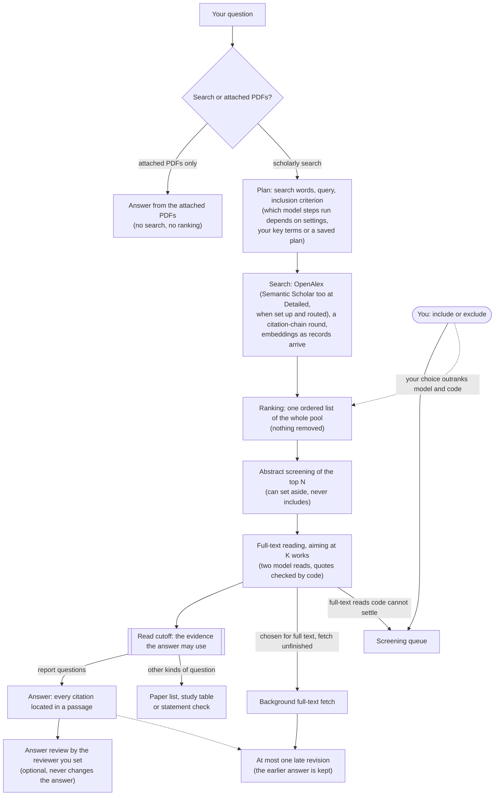
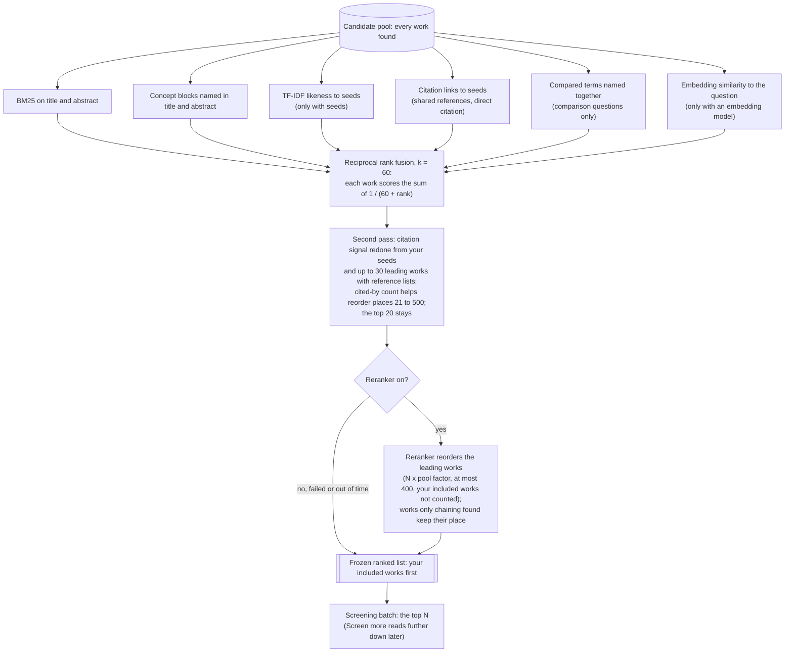

# How DEIXIS searches, ranks and reads

This page follows a question from the moment you ask it to the answer. It describes the current code (run policy `fast_path_v1`) for readers; the code is the exact rule. How well the ranking does on three test sets is in [benchmark.md](benchmark.md).

A run has five stages: plan, search, ranking, read and answer. Each stage gets a time allocation, and time a stage leaves unused carries over to the next. Search, ranking and read stop at a cutoff when their time runs out; the plan and answer allocations only record time and stop nothing. Every step is stored, and a step that succeeded is reused instead of being run again. After a crash or restart, steps that were in progress are marked "outcome unknown" and the run waits for you to resume it; a request that was in flight may then be sent again.

You decide in three places. Full-text reads the code cannot settle go to the screening queue, for example when a quote cannot be found in the text or the two model reads disagree. (At the abstract stage such cases keep the work as a candidate for full text instead.) Your include or exclude outranks any model or code decision and keeps its reason. Works you include go to the top of a later ranked list and act as seeds for the ranking. Screen more, follow-up questions, snowball rounds and the citation map start only when you start them.

## Where the search goes

The registry ([providers/registry.py](../deixis/providers/registry.py)) holds OpenAlex, Semantic Scholar, Crossref, arXiv, bioRxiv, PubMed, IEEE Xplore, Scopus, CORE and SerpApi. A discovery run searches OpenAlex: one semantic request with the question's English sentence, and keyword requests taken in turn across the queries until a record cap or the search deadline. OpenAlex keyword search covers title and abstract, not full text. At Detailed depth one Semantic Scholar bulk request can add records, when Semantic Scholar is among the research's sources and the plan routed a query to it. Queries planned for the other providers are not sent, and the plan records why. For works near the top of the list that lack an abstract, Semantic Scholar, Crossref and Scopus can be asked for one, when they are set up and allowed for the research; the number of lookups is bounded.

## How the query is built

Code picks the search words from your question. It does not translate: a question that is not in English and has no English key terms pauses and asks for them. A model sorts the words into concept blocks (skipped when, for example, you typed key terms or saved a plan), and code counts each term on OpenAlex. Another model call writes the keyword query, a few terms per block with backups; code counts each term, and a term that finds nothing alone can be replaced by a backup. The model is not asked when you typed key terms or when the app is set to use the code's query only, and a query already written for the same question revision is reused. The code's own query is normally searched beside the model's. If the model call fails, the run pauses; the code's query is searched alone only if you choose it. A search plan you saved replaces the model's query. Model calls propose the inclusion criterion unless a saved plan sets it or one is already frozen for the same question. The protocol, with its search plan, is frozen before the search stage sends its requests.

## Seed PDFs

You can attach up to five seed PDFs. First, before the query is planned, each is matched to an OpenAlex work from its first pages. A match needs the work's title at the start of the PDF and only one work that fits; a DOI printed in the PDF is not enough on its own. The match is frozen in the protocol. The query writer reads each seed's excerpt, each seed with text sends its own semantic request, and matched seeds become the first citation-chain seeds. In the ranking, seed PDFs and works you included act as seeds for the TF-IDF and citation signals; for the citation signal, each work counts only the seed PDF nearest to it.

## Citation chaining and embeddings

While the keyword pages arrive, one round of citation chaining runs on OpenAlex. Its seeds are the matched seed PDFs, then works the semantic request returned. Backward requests fetch works the seeds cite and forward requests fetch works that cite them; how many depends on the depth. If the round has fewer seeds than the depth allows when the search stage closes, the pool is ranked at that moment and the gap is filled from the top. At the same time an embedding model (Gemini, OpenAI, Voyage, Cohere, Ollama, LM Studio, a built-in model, or none) embeds each record's title and abstract as it lands. A record not embedded by the cutoff gets no embedding score.

## Ranking

The ranking sets the order in which works are read. The ranking itself removes nothing and decides nothing.

Each signal ranks the whole pool on its own, and the ranks are fused, never the raw scores. A signal that cannot run (no seeds, not a comparison question, no embedding model) is left out and the run records why. A work a signal cannot score (TF-IDF without an abstract, the citation signal without a reference list) is ranked last in that signal but still counts. Ties are broken by record id, so the same input always gives the same list. Everything the list is computed from is stored with it, and the list is rebuilt from those stored inputs rather than from the live database.

The second pass recomputes the citation signal from your seeds plus up to 30 of the best-placed works that have a reference list, with a seed's citation of a work counting double, and fuses the pool again (when none of those seeds has a reference list, the first citation signal stands). It then adds a signal from each work's OpenAlex cited-by count and uses it, with the citation signal weighted up, to reorder places 21 to 500; the top 20 stays in front. The reranker is on by default (Voyage `rerank-3-lite`; without a Voyage key nothing is sent and the fused order stands). It scores the leading works of the fused order, not counting works you included: N times the pool factor (default 4), rounded up, and at most 400. Works in that window that only chaining found keep their place. It reads only the question and each work's title and abstract. If it fails or runs out of time, the list keeps the fused order and no other reranker is tried.

## Reading

The discovery run screens the top N of the frozen list. The abstract stage reads works in small batches, each read twice by the model, after code settles what title and abstract already decide. It can set a work aside or keep it as a candidate; it never includes one, because inclusion needs a full-text read. The run then aims to read K works in full text, in list order. K is a target, not a hard limit: a work already claimed for full text keeps its slot, so the count can end above K, and a work whose text cannot be found, or whose PDF is not confirmed to be that work, gives its slot to the next one. Full-text adjudication asks the model twice, mostly over different passages, and code checks every quote against the text. A work is included without you only when every core part of the criterion is backed by a verified quote and the two reads do not contradict each other. Works chosen for full text whose fetch had not finished at the cutoff keep being fetched in the background.

## The answer

For a question that asks for a report, an answer run normally starts on its own when the discovery run finishes; other kinds of question end with a list of papers, a study table or a statement check instead. The automatic answer reads what the cutoff froze: full-text passages of included works and the abstracts of screened works that are still candidates. An answer you start later can also use works you included since, candidates from Screen more, and snowball candidates once you include them. Full-text passages are ranked by BM25 on the question's terms, fused (RRF) with the passages that match the criterion; there is no semantic passage search here. Passages that report results, and formula passages on a formula question, can be moved up. Passages are shared breadth first, at most 6 per work. A citation must be located in a passage the answer step was given, or the answer stays an unverified draft. If background full text arrives later, it can produce one revision. The attached-PDFs-only path skips search and ranking: the answer ranks the PDFs' passages by keyword match (and by meaning, when an embedding model is set), and a short single PDF can go in whole.

## Depth numbers

From `MODES` in [fast_path.py](../deixis/workflow/run/fast_path.py), except the answer passage budget, which comes from the effort budgets in [rules.py](../deixis/domain/rules.py); all are frozen into each run when it starts. Only search, ranking and read apply a cutoff; plan and answer time is recorded, not enforced. A run on a model that runs on your own computer has no read cutoff.

| | Quick | Standard | Detailed |
|---|---|---|---|
| Stage time allocations, plan / search / ranking / read / answer (s) | 30 / 30 / 30 / 60 / 30 | 30 / 45 / 60 / 120 / 45 | 45 / 90 / 120 / 270 / 75 |
| Works screened by abstract in the run (N) | 25 | 50 | 100 |
| Full-text target (K) | 10 | 20 | 40 |
| OpenAlex keyword records, at most | 450 | 1,000 | 1,500, plus up to 500 from Semantic Scholar when it is searched |
| Citation-chain seeds, at most | 10 | 20 | 30 |
| Answer passage budget (base) | 16 | 48 | 80 |

The passage budget grows when the answer input holds many works, so every work gets room; the answer gets fewer passages when fewer are available.

## What the benchmark measures

The score in [benchmark.md](benchmark.md) is recall@k: the share of a question's gold papers (chosen by experts or survey authors) found in the first k places of the ranked list, averaged over questions. The benchmark page explains its date filtering and how failed questions count. It measures search and ranking only. Screening, full-text reading and answers are not scored.

## Limits

- Ranks, embeddings, cited-by counts, the reranker and model screening are priority signals, not relevance verdicts. A low place is not a judgement that a work is irrelevant, and it says nothing on its own about whether the work was read (an earlier run may have read it).
- Found, screened, read in full, given to the model and cited are separate counts, and each work keeps its reading depth (metadata, abstract, passage, full text). A large pool says little about how much was read.
- Search goes to OpenAlex, and to Semantic Scholar only at Detailed depth when it is set up and routed. The OpenAlex keyword search does not match full text.
- Code checks that each citation points to a located passage. It does not check that the passage supports the claim; the optional answer review is one more model's opinion.
- Deadlines make results depend a little on provider speed, and no search result proves a question is new.

## Where it lives in the code

- [workflow/run/fast_path.py](../deixis/workflow/run/fast_path.py): stages, time allocations, depth numbers
- [workflow/run/flow.py](../deixis/workflow/run/flow.py): plan stage and run order
- [workflow/search/search.py](../deixis/workflow/search/search.py), [workflow/search/fast_chain.py](../deixis/workflow/search/fast_chain.py), [workflow/search/fast_embedding.py](../deixis/workflow/search/fast_embedding.py): search stage
- [workflow/search/ranking.py](../deixis/workflow/search/ranking.py), [workflow/search/small_batch.py](../deixis/workflow/search/small_batch.py), [documents/rerankers.py](../deixis/documents/rerankers.py): ranking and the frozen list
- [workflow/read/read.py](../deixis/workflow/read/read.py), [workflow/screen/abstract_stage.py](../deixis/workflow/screen/abstract_stage.py), [workflow/read/adjudication.py](../deixis/workflow/read/adjudication.py): reading
- [workflow/answer/answer.py](../deixis/workflow/answer/answer.py), [workflow/answer/late_revision.py](../deixis/workflow/answer/late_revision.py): answer and late revision
